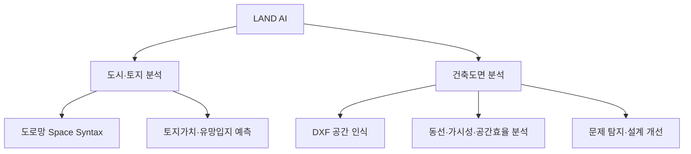

# 서비스를 두 모듈로 나눈다 — 도시·토지 분석과 건축도면 분석

> ⚠️ **2026-09-25: 「뜰 자리」도 제품 결론이 아니다.** 검증(§15·§24)에서 미래 성장률과의
> 상관이 0이라 내렸다. 제품 결론은 **「구조가 받쳐 주는 자리」+「이미 늦은 자리 경고」**이고
> MVP는 상권 현재 분석 + 도면 분석 두 모듈이다. 근거는 `DECISIONS_LAND_MODEL.md` §26.
> 아래 본문의 「뜰 자리·오를 확률·유망입지·미래전망」은 **연구 트랙의 말**이지 화면 문구가 아니다.
>
> ⚠️ **2026-08-26 이후 이 문서의 「저평가」는 제품 결론이 아니다.**
> 제품은 **B(뜰 자리 — 같은 계층 대비 초과상승 확률)** 단일 결론으로 간다. 저평가 계산은
> 유지하되 갭 지표는 **뜰 자리 모델의 입력 feature**로만 쓴다(반증 불가 + 감정평가법상
> 위험). 근거는 `docs/DECISIONS_LAND_MODEL.md` §10.
> 아래 본문에서 「저평가·고평가」가 **사용자 화면의 결론**으로 나오는 대목은 전부
> 「뜰 자리(오를 확률)」로 읽는다. 화면에 "싸다"로 나가면 안 되고 "오를 확률이 높다"로
> 나가야 한다. 내부 계산·통제 방법을 설명하는 대목은 그대로 유효하다.


**상태: 소유자 구술(2026-08-24)을 옮긴 구조 결정.** 화면 세부는 아래 각 모듈의
문서로 넘긴다. 이 문서는 **무엇이 어디에 속하는지**와 **공통 표시 규칙**만 정한다.

이 문서는 `docs/SPEC_FLOORPLAN_TABS_UI.md`를 **버리지 않고 그 위에 얹힌다.** 그쪽은
도면 화면의 탭 구성이고, 여기는 그 화면이 서비스 어디에 붙는지와 두 모듈이 공유하는
설명 규칙이다. 충돌하는 대목은 아래 「뒤집는 결정」에 모았다.

---

## 1. 왜 나누는가

Space Syntax 결과를 **토지가격 예측 화면 안에 억지로 넣지 않는다.** 분석 대상이
다르기 때문이다 — 하나는 도로망이고 하나는 건물 안이다. 같은 화면에 넣으면 사용자가
지금 보는 값이 필지의 값인지 방의 값인지 알 수 없다.



**Space Syntax는 제품의 얼굴이 아니라 엔진이다.** 별도 결과도 보여주지만, 최종적으로는
업무 문제를 판단하는 데 쓴다. 대외 문장도 지표 이름을 앞세우지 않는다:

> LAND AI는 도시의 길과 토지의 가치를 분석하는 데서 끝나지 않고, 건축도면 내부의
> 동선과 공간구조를 분석해 설계 개선까지 제안합니다.

한 줄로는 — **도시에서 건축 내부까지 공간의 성능을 설명하는 AI.**

---

## 2. 공통 표시 규칙 — 두 모듈이 똑같이 지킨다

### 2.1 값을 보여주는 순서는 네 단계다

공간이든 도로든 **클릭하면 오른쪽에 이 순서로** 나온다. 지표 이름부터 보여주지
않는다.

| 순서 | 무엇 | 예 |
| --- | --- | --- |
| 1 | **판단** | 접근성은 높지만 동선 충돌 가능성이 큰 공간입니다. |
| 2 | **업무상 영향** | 방문자는 목적지를 쉽게 찾지만 입고 시간에는 로비 혼잡이 발생할 수 있습니다. |
| 3 | **분석 근거** | 찾아오기 쉬운 정도 상위 8% · 지나다니는 정도 상위 4% · 동선 중첩 12m · 병목 후보 2곳 |
| 4 | **개선 방법** | 물류 출입구를 동측 서비스 공간과 연결하면 고객 동선과의 중첩을 없앨 수 있습니다. |

**원자료는 「상세 지표 보기」를 눌렀을 때만** 낸다 — Integration·Choice·VGA 값과
백분위, 계산 조건이 거기 들어간다.

### 2.2 이름은 쉬운 한국어, 전문 용어는 설명 안에서만

이미 저장소의 규칙이다(`frontend-next/lib/metricInfo.ts`). 새로 만들지 않고 그대로
쓴다:

- 화면에 처음 보이는 이름은 누구나 아는 쉬운 한국어. **영어 금지.**
- '통합도'·'가시성 그래프' 같은 말은 ⓘ 설명과 「상세 지표 보기」 안에서만.
- LLM 설명도 전문 용어를 쓰지 않는다(백엔드 시스템 프롬프트에서 강제).

실내판 용어는 `frontend-next/lib/floorplanTerms.ts`에 있다. 같은 지표·같은 식이지만
말이 다르다 — `metricInfo.ts`의 설명은 도로망의 말("동네", "길", "골목")로 쓰여
있어서 실내에 그대로 쓰면 무엇을 말하는지 알 수 없다. 지표 키는 일부러 양쪽이 같다.

### 2.3 설명은 LLM이 숫자를 보고 지어내지 않는다

```
계산 → 규칙 기반 판단 → 공간 용도 반영 → AI 설명
```

LLM에 숫자를 던지고 해석하게 하면 안 된다. 먼저 분석 시스템이 **구조화된 결과**를
만든다:

```
선택 공간: 중앙 홀
공간 용도: 공용공간
Integration percentile: 92
Choice percentile: 96
Visual connectivity percentile: 81
직접 연결 공간: 6
방문자·물류 동선 중첩: 12m
병목 후보: 2곳
```

그다음 **규칙과 공간 용도를 결합**한다:

```
Choice 상위 10%          → 이동 집중 가능성
동선 중첩 10m 이상       → 사용자 충돌 검토
공용공간 + Integration 높음 → 접근성에 유리
업무공간 + Choice 높음   → 통행 간섭 가능성
```

마지막에 LLM이 자연어로 옮긴다. **같은 수치를 공간 용도에 따라 다르게 읽는 것이
이 구조의 요점이다** — 지나다니는 자리는 라운지에는 좋고 집중 업무공간에는 나쁘다.

---

## 3. 모듈 1 — 도시·토지에서의 Space Syntax

### 지도에 올리는 것

Global Integration · Local Integration · Choice · Connectivity ·
Angular Mean Depth. 분석 반경은 **400m / 800m / 1,200m**를 고르게 하고,
**현재 도로망 / 개발 후 도로망**을 갈아 볼 수 있게 한다.

### 패널은 §2.1 네 단계를 그대로 따른다

```
판단        대상 필지는 지역 내부 접근성은 높지만 광역 이동경로에서는
            다소 벗어나 있습니다.

업무상 의미  생활밀착형 상업시설에는 유리하지만, 외부 방문객을 끌어들이는
            대형 목적형 시설에는 상대적으로 불리할 수 있습니다.

분석 근거    Local Integration 상위 8% · Global Integration 상위 34%
            Choice 상위 21% · 직접 연결 도로 4개 · 주요 교차로까지 180m
```

### 그리고 토지가치 분석으로 이어 붙인다 — 이 연결이 모듈 1의 핵심이다

```
Space Syntax 결과 → 상권·접근성 해석 → 가격 모델 기여도 → 뜰 자리 판정
```

> 높은 국부 통합도와 유동인구가 모델 기준 공시지가를 높이는 요인으로 작용했습니다.
> 하지만 실제 개별공시지가는 유사 필지보다 낮고 인근에 건축 허가가 이어져,
> 같은 계층 필지들보다 더 오를 후보(뜰 자리)로 분류되었습니다.

⚠️ **이 문장을 그대로 쓰기 전에 `docs/DECISIONS_LAND_MODEL.md`의 순환성 경고를 볼
것.** 공시지가는 비교표준지 × 비준표 배율이고 비준표 항목에 도로접면·도로거리가 들어
있다. Space Syntax 지표가 "공시지가를 높이는 요인"이라고 말하려면 **도로접면·도로거리·
용도지역을 통제한 뒤의 증분**이어야 한다. 통제 전 기여도를 인용하면 행정 산식을
재현한 것을 발견이라고 말하는 셈이다. 이슈 #30의 ablation이 그 증분을 재고 있다.

---

## 4. 모듈 2 — 건축도면 분석

### 4.1 입력

| 입력 | 지금 | 비고 |
| --- | --- | --- |
| DXF | ✅ 받는다 | 유일하게 받는 형식 |
| DWG 변환 파일 | ⚠️ | DXF로 변환해 넣으면 같다. 변환은 우리가 안 한다 |
| PDF 평면도 | ❌ **받지 않는다** | 소유자 확정(2026-08-24). 아래 §6.1 |
| IFC/BIM | ❌ 없다 | 새 파서 필요 |
| 건물 용도 | ❌ 없다 | **받아야 한다** — 아래 |
| 층 정보 | ❌ 없다 | 라우터가 파일 하나·모델스페이스 하나만 본다 |
| 주요 사용자 | ❌ 없다 | **받아야 한다** |
| 출입구·목적 공간 | ❌ 없다 | 인식 자체가 없다 |

**건물 용도와 주요 사용자를 받아야 AI가 같은 수치를 다르게 해석할 수 있다.**
이것이 §2.3 파이프라인의 「공간 용도 반영」 단계가 성립하는 조건이다.

| 용도 | 주요 사용자 |
| --- | --- |
| 오피스 | 방문자 · 직원 · 물류 |
| 병원 | 환자 · 의료진 · 보호자 |
| 상업시설 | 고객 · 직원 · 배송 |
| 학교 | 학생 · 교직원 · 방문자 |

### 4.2 처리 세 단계

**① 도면 요소 인식** — 벽 · 문 · 창문 · 공간 경계 · 실명 · 출입구 · 계단·엘리베이터 ·
복도 · 가구와 장애물. 인식 결과를 **사용자에게 확인받는다**:

> 공간 18개, 문 21개, 주출입구 2개를 인식했습니다.
> 문으로 추정한 요소 3개를 확인해주세요.

이 확인 단계는 장식이 아니다. 지금 추출기는 벽 레이어 이름을 문자열 포함으로
가르는데, 이름이 다르면 **전 레이어를 벽으로 삼고 개구부를 통째로 버린다** — 문이
하나도 없는 밀폐 도면으로 분석되고 경고도 안 뜬다(`SPEC_FLOORPLAN_TABS_UI.md`
실사 절).

**② 공간 그래프 생성** — 공간을 Node, 문과 연결관계를 Edge로. 이동 가능 영역,
시야를 막는 벽과 장애물, 출발지·목적지, 사용자별 이동 가능 경로.

⚠️ **지금의 계산은 이 그래프가 아니다.** 현재 경로는 격자 위의 **가시성 그래프**이고,
거기서는 **벽 너머로 보이는 칸이 이웃**이다. 그 위의 최단경로는 벽을 통과한다.
동선을 내려면 **보행 그래프를 따로** 세워야 하고, 그러면 격자 하나에 그래프가 둘이라
5초 예산을 다시 잡아야 한다.

**③ Space Syntax 계산**

| 묶음 | 지표 | 지금 |
| --- | --- | --- |
| 공간 연결관계 | Connectivity | ✅ |
| | Integration | ✅ |
| | Mean Depth | ⚠️ 내부 계산은 있고 응답에 안 실린다 |
| | Control Value · 공간 간 단계 수 · Justified Graph | ❌ |
| 이동 | Angular Choice · 최단경로 · 방향 전환 · 이동거리 · 통과 공간 · 병목 | ❌ (보행 그래프 선행) |
| 가시성 | VGA · Visual Integration · Visual Connectivity | ✅ 격자 단위로 있다 |
| | Isovist Area · 시야 깊이 · 사각지대 · 입구→목적지 가시 여부 | ❌ |

**사용자가 이 메뉴를 직접 다룰 필요는 없다.** 아래 업무 탭이 이걸 번역한다.

### 4.3 화면은 업무 탭이다 — Space Syntax 탭을 만들지 않는다

| 업무 탭 | 무엇을 답하나 | 쓰는 지표 |
| --- | --- | --- |
| **발견된 문제** | 지금 손봐야 할 것 (default) | 전부 결합 |
| **사용자 동선** | 누가 어디를 어떻게 지나가나 | Choice · Depth |
| **길 찾기·가시성** | 보이는가, 헤매는가 | VGA · Isovist |
| **공간 관계** | 가까워야 할 것이 가까운가 | Integration · Mean Depth · Connectivity |
| **설계 개선** | 어디를 어떻게 바꾸면 되나 | 변경 전후 재계산 |

**발견된 문제**가 자동으로 찾는 것: 이동이 과도하게 집중되는 공간 · 지나치게 고립된
공간 · 길 찾기 어려운 분기점 · 사각지대 · 동선 충돌 · 막다른 공간 · 프라이버시 노출.

```
문제 ① 중앙 홀에 이동이 과도하게 집중됩니다.
  근거  Choice 상위 5% · 직접 연결 공간 6개
        방문자·직원 동선 중첩 12m · 예상 병목지점 2곳
```

**길 찾기·가시성**이 답하는 질문: 입구에서 안내데스크가 보이는가 · 엘리베이터에서
목적지 방향이 인식되는가 · 첫 분기점에서 선택지가 너무 많은가 · 표지판이 필요한
위치는 어디인가 · 감시 사각지대는 어디인가 · 프라이버시가 노출되는 공간은 어디인가.

**공간 관계**가 답하는 질문: 가까워야 할 공간이 가까운가 · 분리되어야 할 공간이
연결되어 있는가 · 이동 단계가 너무 많은가 · 특정 공간에 가려면 다른 공간을 통과해야
하는가.

**설계 개선**은 문이나 벽의 변경을 시뮬레이션하고 **전후를 다시 계산**한다 —
이동거리 · 방향 전환 · Integration · Choice · 가시성 · 동선 중첩 · 사각지대의 변화.
그리고 **좋아진 것만 말하지 않는다**:

> 회의실 문을 로비 방향으로 옮기면 방문자 이동거리가 11% 감소하고 업무공간 통과가
> 제거됩니다. 그러나 회의실 내부의 시각적 프라이버시는 낮아질 수 있습니다.

---

## 5. 대외 자료 구성 — 3장에서 4장으로

건축도면 분석까지 3장에 넣으면 복잡해진다. 최소 4장으로 나눈다.

1. **LAND AI가 해결하는 문제** — 상대가치 · 미래 유망입지 · 공간설계
2. **도시·토지 분석** — 토지가치 · 입지 · 상권 · 도로망 Space Syntax
3. **건축도면 분석** — DXF → 공간 인식 → 동선·가시성·효율·안전 → 개선안
4. **통합 구조와 MVP** — 도시에서 좋은 입지를 찾고, 건물 내부의 좋은 공간까지 설계

---

## 6. 뒤집는 결정

### 1. PDF 평면도는 받지 않는다 — 확정 규칙을 그대로 유지한다

구술 단계의 입력 목록에 PDF 평면도가 들어 있었지만 **받지 않기로 확정했다**
(소유자, 2026-08-24). `CLAUDE.md` §7과 `docs/ARCHITECTURE_RULES.md`가 그대로
유효하다:

> `/api/floorplan/extract`는 **DXF만 받고**, 사진·스캔 이미지는 프론트와 백엔드
> **양쪽**에서 막는다. 갈리는 기준은 파일 형식이 아니라 **정면에서 그린 벡터
> 도면이냐 사진이냐**다.

이유는 확장자가 두 가지를 같이 담는다는 것이다 — **벡터 PDF는 선을 뽑을 수 있지만
스캔 PDF는 사진이다.** "PDF를 받는다"고 열면 스캔본이 같은 문으로 들어오고, 그때
추출기는 선을 못 찾은 것이 아니라 **없는 선을 찾은 척** 하게 된다. 벡터만 통과시키는
판정을 넣는 것보다 문을 닫아 두는 쪽이 싸고 정직하다.

DWG는 사용자가 DXF로 변환해 넣으면 같다 — **변환은 우리가 하지 않는다.**

### 2. ⚠️ Space Syntax 화면의 위치가 두 번 바뀌었다 — 이 결정이 최종이다

같은 날 세 가지 지시가 있었고 문서가 그걸 기억해야 한다:

| 시점 | 지시 | 결과 |
| --- | --- | --- |
| ① | Space Syntax를 전용 탭으로 만들지 않고 각 문제의 「분석 근거」에 넣는다 | `SPEC_FLOORPLAN_TABS_UI.md` |
| ② | 도면 데모를 Space Syntax 지표 계산·해석 위주로 좁힌다 | `lib/floorplanVga.ts` (실제 계산) |
| ③ | Space Syntax 탭을 만들지 말고 업무 탭 안에서 쓴다 | **이 문서 §4.3** |

**①과 ③은 같은 말이고 ②는 엔진에 대한 말이다.** 셋을 화해시키면:
지표는 **엔진으로 제대로 계산하고**(②), 화면은 **업무 탭으로 번역하며**(①③),
원자료는 **「상세 지표 보기」 안에만** 둔다(§2.1). ②에서 만든 용어집과 계산 엔진은
버리지 않고 그 「상세 지표 보기」와 ⓘ의 내용이 된다.

---

## 7. 미결

1. **Q2** 건물 용도와 주요 사용자를 어디서 받나 — 업로드 단계인가 분석 설정인가.
2. **Q3** 보행 그래프를 세우면 5초 예산을 어떻게 다시 잡나(격자 하나에 그래프 둘).
3. **Q4** 규칙 기반 판단의 문턱값(Choice 상위 10%, 중첩 10m 등)을 무엇으로 정하나 —
   문헌인가 실측인가 전문가 판단인가. 지금 이 숫자들은 근거가 밝혀지지 않았다.
4. **Q5** 도시·토지 쪽에서 "Space Syntax가 공시지가를 높였다"를 말할 수 있는 조건 —
   순환성 통제 후 증분이 나오기 전까지 이 문장을 쓸지 말지.
5. **Q6** 층·프로젝트 저장소 — 만들면 처음으로 로그인·소유권이 필요한 화면이 된다.
6. **Q7** IFC/BIM을 로드맵에 둘지, 범위 밖으로 못 박을지.
7. **Q8** 브라우저 계산을 어디로 옮길지. 같은 평면(927칸)이 Node에서 **117ms**인데
   배포된 브라우저에서 **4,246ms**로 실측됐다(2026-08-24, 당시 `/demo/floorplan`;
   지금은 `/demo`의 「평면 공간구조 분석」). 5초 룰 안이긴 하나 그 4초 동안 **UI
   스레드가 멈춰 탭이 안 눌린다** — 데모에서는 자동 재생 시나리오까지 함께 멈춘다. 웹 워커로 옮길지,
   격자를 더 성기게 할지, 서버 계산으로 되돌릴지 정해야 한다. 원인부터 재야 한다 —
   같은 V8인데 36배 차이가 날 이유가 코드에는 없다.

## Out of Scope

- 자동 도면 수정(AI가 직접 벽을 옮기는 것). 어디를 어떻게 바꾸면 되는지 **표시**까지.
- 3D · 일조 · 음향 · 열환경.
- 법규 적합성 최종 판정.

---

## MVP 골격 (2026-09-25) — 지금 있는 것에서 무엇을 고치나

`DECISIONS_LAND_MODEL.md` §26의 결정을 코드 단위로 옮긴 것이다. **외주 SOW의 뼈대**로
쓴다. 상태 표기: ✅ 있음 · 🟡 있지만 고쳐야 · ❌ 없음.

### A. 상권 현재 분석 모듈 (`/demo` 상권 6탭 → 제품)

**A1. 데이터 — 새 파생 테이블 `trdar_structure`** ❌ (소유자)
상권 1,648행. 열: `integration_r1000_mean/p90`, 면적 통제 구조 백분위, 현재 매출
5분위, 매출 상위 10% 여부, **성숙도 플래그**(구조 p90 상위 ∧ 매출 상위 → 고점 경고).
`tools/compute_trdar_structure.py` 신설 — §23의 공간조인(`road_segment_structure` ×
`trdar_area`)을 재사용하고, 검증 스크립트처럼 매번 조인하지 않고 **한 번 계산해 적재**한다.
**운영 DB에도 올렸는지 확인** (CLAUDE.md §1의 빈 값 사고).

**A2. API** 🟡 (소유자)
- `SiteScoreResponse`에 `structure` 블록 추가 — 판단 / 업무상 영향 / 근거 / 개선의
  4단계(위 §2.1) + `detail`(Integration·백분위·계산 조건)은 「상세 지표 보기」용.
- `maturity_warning` 필드 — 고점 경고 문장과 근거(§15 수치).
- `TrendsResponse.street_signals`에 평균회귀 경고를 하나 더.
- 기존 `subscores`의 공간구조 항목(`_ss_detail`)은 A1 값으로 교체.

**A3. 프론트 — `app/demo/page.tsx`의 상권 6탭을 제품 화면으로** 🟡 (외주)
`lib/demoTrade.ts`의 고정 표를 `lib/api.ts` 호출로 바꾼다. 탭별 재료:

| 탭 | 재료 | 상태 |
| --- | --- | --- |
| 종합 | site-score 한 줄 + 구조 점수 + 고점 경고 | 🟡 문구 교체 |
| 입지진단 | site-score `subscores` + A2 `structure` 4단계 | 🟡 |
| 수요·도달권 | `/api/isochrone`, `/api/area-insights` | ✅ 연결만 |
| 경쟁·잠식 | `/api/real-competition`, `/api/cannibalization` | ✅ 연결만 |
| 매출·손익 | `trdar_sales`(분기 단위 표기 유지), `/api/profitability/*` | ✅ 연결만 |
| 상권추세 | `/api/trends` + A2 경고 | 🟡 |

2,048줄 한 파일이라 **탭 컴포넌트를 `components/trade/`로 쪼개는 것**이 외주 첫 작업이다.
데모의 자동 재생 장면(`SCENES`)은 별도 라우트로 남기거나 지운다.

**A4. 내릴 것** (소유자, 반나절)
- `AppShell` 「저평가 부지」 탭과 `UndervaluedPanel`·`UndervaluedParcelList` — §10에서
  결론을 내렸는데 탭이 남아 있다.
- `/demo`의 토지가치 6탭 장면(`TABS`, `chatLand`)과 「유망입지」「미래전망」 문구.
- `/land` 라우트는 연구용으로 남기되 진입 메뉴에서 뺀다.

**A5. 진입 화면** ❌ (외주)
분석 종류 두 개(상권 분석 / 도면 분석)를 고르는 첫 화면. 토지가치 분기는 넣지 않는다.

### B. 건축도면 분석 모듈 (`FloorplanAnalyzer.tsx`)

| 스펙 7탭 | 지금 | 남은 것 |
| --- | --- | --- |
| 발견된 문제 | ✅ `view="issues"` 기본 뷰, 규칙 6개 + LLM 해석 | 담당자 메모·검토 완료(상태 저장 필요) |
| 사용자동선 | 🟡 지표 오버레이(목·지나가는 길목·시야)로 대체 | 동선 경로 표시, 출입구→목적지 흐름 |
| 공간효율 | 🟡 `view="rooms"` 공간별 비교 표 | 면적 대비 활용도 판정 문장 |
| 안전·접근성 | ❌ | 계단·엘리베이터·출입구 인식은 있음(9/18) → 대피 거리·병목 규칙 |
| 설계개선 | ❌ | 개선안을 도면 위에 표시 (지금은 벽 편집 → 재분석만) |
| A/B 비교 | ✅ `/api/floorplan/compare` | 화면 정리 |
| 보고서 | ✅ `lib/floorplanReport.ts` | PDF·표지 |
| 0단계 인식 확인 | 🟡 벽 편집 캔버스 | 실명·문 인식 결과를 사람이 고치는 화면 |

**탭 바 자체가 없다** — 지금은 툴바 버튼 토글이다. 스펙 §1 레이아웃(도면 70% 고정 +
오른쪽 패널 30% + 하단 AI 질문)으로 바꾸는 게 외주 첫 작업이다.

### C. 공통 (외주 붙이기 전, 소유자)

- **PR 워크플로.** 지금은 main push = 라이브다(CLAUDE.md §3). 외주 브랜치 → PR → 소유자
  리뷰 → merge로 바꾸고, 스테이징 환경(Railway·Firebase 프리뷰 채널)을 하나 연다.
- `OWNERSHIP.md`의 소유 경로에 외주 영역(`components/trade/**`, `components/floorplan/**`)을
  추가한다. 공유 계약(`schemas.py`, `api.ts`)은 소유자가 먼저 굳힌다.

### D. 순서

| 주 | 소유자 | 외주 |
| --- | --- | --- |
| 1~2 | A1 · A2 · A4 · C (계약이 굳어야 외주가 붙는다) | 선정·계약 |
| 3~8 | 토지 모델 연구 트랙, 고객 인터뷰, 투자 덱 | A3 → A5 → B 탭 바·설계개선 |
| 9~10 | 검수, 파일럿 고객 시연 | 잔금·인수인계 |

## 필지별 길 구조 등급 — 분양·매입 배분 근거 (2026-09-30)

`backend/app/services/parcel_structure.py` + `POST /api/parcel-structure`.

**무엇**: 좌표와 반경을 주면 그 안의 필지를 읽어, 각 필지가 **접한 도로의 구조값**을
붙이고 **그 범위 안에서** 1~5등급으로 줄 세운다. 총액을 넣으면 필지별 배분 금액까지 낸다.

**어떻게**: 새 지표를 만들지 않았다. 이미 적재된 `road_segment_structure`(170,707구간,
반경 500m)를 읽기만 하므로 런타임에 공간구문론을 다시 돌리지 않는다 — 논현 1,070필지
실측 **3.0초**(5초 룰 안). 필지 경계에서 20m 안의 도로를 「접한 도로」로 보고, 그중
**가장 좋은 값**을 쓴다(코너 필지가 큰길을 잃지 않게).

**집계 방식은 실측으로 골랐다.** 강남 논현 1,066필지를 2026년 공시지가와 대조:

| 집계 | 구조 5분위별 공시지가 중앙값(만원/㎡) | 최고/최저 |
| --- | --- | --- |
| **타일 백분위 · 최대** (채택) | 1094 → 1163 → 1194 → 1176 → **2085** | **1.91배** |
| 원값 · 최대 | 1094 → 1268 → 1145 → 1176 → 1735 | 1.59배 |
| 가장 가까운 도로 | 1098 → 1119 → 1267 → 1219 → 1229 | 1.12배 |
| 거리가중 평균 | 1119 → 1157 → 1222 → 1218 → 1251 | 1.12배 |

⚠️ **갈리는 건 맨 위 한 칸뿐이다.** 2~4분위는 서로 구분되지 않는다 — 이 지표는 "특급
자리인가 아닌가"를 가르지 세밀한 등급을 매기지 못한다. 화면·보고서가 그 이상을 말하면
안 되고, 응답의 `caveats`가 이 문장을 항상 싣는다.

⚠️ **공시지가 순환성**(CLAUDE.md §4): 비준표에 도로접면·도로거리가 들어 있어 길 구조와
겹친다. 위 1.91배는 "우리 지표가 옳다"가 아니라 **"행정이 매긴 값과 같은 방향을 본다"**
정도다. 매출 검증은 상권 축에만 있고 **필지 단위 매출 검증은 없다.**

**결론 문구**: 금액을 단정하지 않는다. "이 필지는 얼마다"가 아니라 **"같은 범위의 다른
필지에 견줘 길 구조가 몇 등급"**이고, 금액은 사용자가 총액을 넣었을 때의 **배분 비율**로만
나간다. 감정평가가 아니라는 문장을 응답에 항상 붙인다.

**설계 선택**
- 등급은 언제나 **요청 범위 안의 상대값**이다. 구조값 자체가 반경 500m 안의 상대값이라
  서울 전역을 가로질러 비교할 수 없다 — 분양가 배분이 원래 "총액을 나누는" 문제이기도 하다.
- 맹지(접한 도로 없음)는 **0등급이 아니라 등급 없음**이다. 0을 주면 "최악의 자리"로
  읽히는데 실제로는 "모른다"다.
- 구조가 모두 같으면 배분은 **면적 비례로 수렴**한다. 기존 관행에서 얼마나 움직였는지를
  사람이 읽을 수 있게 하려는 것이다.
- 블록 안 상·하위 10% 차이가 1.3배 미만이면 "등급으로 값을 가르는 근거가 약하다"고
  `caveats`에 적는다.

**대상 범위를 어떻게 정하나 (2026-09-30 추가)**: 기본은 **지도에 보이는 만큼**(배율에 따라
반경 150~700m)이다. 그런데 그러면 지도를 조금만 움직여도 대상이 바뀌고 등급도 따라 바뀌어
**보고서에 쓸 수 없다**(소유자 지적). 그래서 `pnus`를 받는 경로를 뒀다 — 화면에서 필지를
눌러 "이게 내 사업지"라고 고르면 그 묶음만 채점하고, 지도를 옮겨도 대상이 흔들리지 않는다.
고른 목록은 브라우저에 남겨 새로고침 뒤에도 이어진다(검토는 하루에 끝나지 않는다).
반경 조회와 지번 조회는 **같은 집계 SQL**(`_AGGREGATE_SQL`)을 쓴다 — 다른 계산을 하면
대상을 좁혔을 때 등급이 미묘하게 달라져 사람이 그 차이를 설명할 수 없다.

**데이터 한계**: `parcel_polygons`는 **강남구·금천구·영등포구**만 덮는다(54,925행). 다른
구 좌표는 404다. 2026-09-30에 소유자가 반포역(서초구)에서 빈 지도를 만났다 — 지도는
나오는데 아무것도 안 칠해지니 "고장 났다"로 읽혔다. 화면이 **어디가 적재돼 있는지 먼저
말하고** 그곳으로 가는 버튼을 두는 것으로 고쳤다. 커버리지 부족을 장애 메시지와 같은
말투로 내지 않는다.

**아직 없는 것**: 계획 도면(지구단위계획·택지)에서 아직 없는 길을 넣고 계산하는 경로
(B안). 이 모듈의 엔진을 그대로 쓰되 도로망 입력만 바꾸면 된다.

## 계획 단계 택지의 획지 등급 (B안, 2026-09-30)

`backend/app/services/planned_site.py` + `POST /api/planned-site`.

A안(`/api/parcel-structure`)은 **이미 있는 동네**를 다룬다 — 적재된
`road_segment_structure`를 읽어 지적도 필지에 붙인다. 택지지구·지구단위계획은 길도
획지도 도면 위에만 있는데, **분양가를 매겨야 하는 시점은 바로 그때**다. 여기가 그
경우를 맡는다.

**입력**: 계획 도로망(폴리라인, WGS84) + 획지(GeoJSON 폴리곤). **출력**: A안과 **같은
등급·배분 함수**(`grade_parcels`·`summarize`)를 통과한 획지별 1~5등급과 배분 비율.
같은 함수를 쓰는 건 의도된 것이다 — 두 경로가 다른 점수를 내면 "계획일 때와 지어진
뒤"를 견줄 수 없고, 그 비교가 이 기능의 쓸모다.

**계산**: 시뮬레이션의 `build_virtual_segments` + `_walk_metrics`를 그대로 쓴다(새 엔진을
만들지 않는다). 거리는 shapely로 EPSG:5179에서 재고, 획지 경계 20m 안의 길을 「접한
길」로 본다 — A안과 같은 기준이어야 비교가 성립한다. 실측 15획지 **0.05초**.

**`include_existing_roads`**: 켜면 중심 좌표 반경 1,200m의 기존 도로를 함께 넣는다.
끄면 계획 도로만으로 돌고, **"이 지구 안에서의 상대값일 뿐"**이라는 경고가 붙는다.

**시험 픽스처**: `tools/make_planned_site_fixture.py` → `frontend-next/public/samples/
planned-site.json`. 간선 1 + 내부순환 1 + 지선 4(하나는 막다른 길) + 획지 15. 실제
지구단위계획 도면은 기관 요청이 필요해 개발이 멈추므로, **구조가 일부러 불균등한**
가상 지구로 파이프라인부터 세웠다. 실측 결과 막다른 지선 끝(14블록)이 최하위,
간선 접한 블록이 최상위로 갈렸다(상·하위 10% 1.92배).

**한계(응답 `caveats`에 항상 실린다)**
- 계획 도면만 본 상대 등급이고 감정평가가 아니다. 분양가를 단정하지 않는다.
- **계획 단계라 실적으로 검증할 대상 자체가 없다.** 길 구조 ↔ 매출 검증은 서울 기존
  상권에서 얻은 것이고 그걸 계획지에 옮겨 적용하는 것이다.
- 맹지(20m 안에 길이 없음)는 0등급이 아니라 **등급 없음**이고, 도면에서 길이 빠진
  것인지 확인하라고 말한다.

**아직 없는 것**: DXF/SHP 계획 도면을 직접 읽는 경로. 지금은 좌표 배열을 받는다 —
DXF는 도면 좌표라 **좌표계 정합(georeferencing)**이 따로 필요해 별도 단계다.
SHP·GeoJSON은 이미 WGS84/5179라 변환만 붙이면 된다(그쪽이 먼저다).
→ 2026-10-02: LH 공고의 **벡터 PDF**로 정합까지 실제로 해 봤다. 아래 「실전 적용 —
운정중앙역 F10」. 아직 서비스 경로(`/api/planned-site`)에는 붙이지 않았다.

### 보고서 내보내기 (2026-09-30)

`frontend-next/lib/parcelReport.ts`. A안·B안 두 화면이 같은 빌더를 쓴다 — 결과 모양이
같으므로 보고서도 하나면 된다.

도면 보고서(`floorplanReport.ts`)와 같은 방식이다: 서버를 거치지 않는 자체 완결 HTML
하나, 열어서 인쇄하면 PDF. **다른 점은 그림을 직접 그린다는 것이다.** 지도는 카카오
타일이라 캔버스로 뽑을 수 없고, 뽑더라도 남의 지도를 보고서에 실어 배포하는 셈이 된다.
대신 우리가 가진 필지 경계를 **SVG로 그린다** — 출처가 분명하고 인쇄에도 깨끗하다.
위도 보정(경도 1도 × cos φ)을 넣지 않으면 필지가 가로로 늘어나 실제 모양과 달라진다.

담기는 것: 등급 색 범례 · 필지 경계 그림 · 요약 수치 · 등급 순 표(순위·지번·면적·등급·
범위 내 순위·접한 길·배분) · **등급을 매기지 못한 필지를 따로** ("나쁜 자리가 아니라
모른다는 뜻") · 한계 문구 전체.

실측: 논현 블록 1,072필지 → 370KB, SVG path 1,072개.

### 필지 경계를 서울 전역으로 (2026-09-30 밤)

**증상**: 도로 구조값(`road_segment_structure`)은 서울 전역에 있는데 필지 경계는 강남·
금천·영등포 세 구(54,925필지)뿐이었다. 그래서 반포역에서 화면이 지도만 보이고 아무것도
칠해지지 않았다 — 계산이 안 되는 게 아니라 **칠할 면이 없었다.**

**조치**: `tools/ingest_parcel_polygons_vworld.py`로 V-World WFS에서 직접 받아 적재했다.
기존 `ingest_parcel_polygons.py`는 국가공간정보포털에서 사람이 로그인해 내려받은 zip을
읽어야 해서, 구를 하나 열 때마다 손이 갔다.

**결과**: **서울 25개 구 838,976필지** (시작 54,925 → 15배). 라이브 실측은 전 구에서
**1초 이내**다(강남 논현 0.8s, 관악 신림 2,041필지 0.6s, 중랑 면목 2,387필지 0.6s).
로컬에서 3초 걸리던 건 DB가 원격이라 그렇고, 서버는 같은 데이터센터에 있다.

| 지역 | 필지 | 상·하위 10% 차이 |
| --- | --- | --- |
| 강남 논현 | 1,070 | 2.79배 |
| 마포 홍대 | 1,585 | 1.93배 |
| 종로 광화문 | 1,130 | 1.70배 |
| 서초 반포 | 117 | 1.60배 |

**방법**: WFS가 한 요청에 1,000건까지만 주므로, 정확히 1,000건이 오면 그 칸을 넷으로 갈라
다시 받는다(꽉 찼다는 건 잘렸다는 뜻). 면적은 PostGIS가 5179에서 잰다 — 파이썬에서
도(degree) 면적을 재면 0.0000x가 나온다.

**주의**: 운영 DB에 직접 쓴 적재다. pnu 기준 upsert라 기존 행을 지우지 않지만, 넓히기
전에 좁은 범위로 먼저 돌려 화면에서 확인했다(CLAUDE.md §1의 원칙).

### 실전 적용 — 운정중앙역 F10, LH 도면 PDF에서 지도 좌표까지 (2026-10-02)

소유자 요청: LH 파주운정3 업무복합용지 F10(동패동 3999, 25,904㎡, 공고 BN-0008014,
입찰 2026-10-28)이 보행 흐름상 어떤 자리인지 이웃 획지와 비교해 카페 게시용 지도·표로.
공급 대상은 F10 **한 필지**뿐이라 비교는 같은 특별계획구역(GTX 역세권)의 F1-1·F1-2·
F2-1·F2-2·업2·주복3·주복4와 했다. 작업물·재현 스크립트는 저장소 밖
`C:\dev\tools\scratch\unjeong-f10\`(README.txt에 실행 순서)에 있다.

**결정 1 — 도로망은 OSM이 주 데이터다.** 소유자 분기("OSM이 부실하면 국가 도로중심선")를
실측으로 판정했다. 같은 범위를 도로명주소 도로구간(VWorld `lt_l_sprd`)·표준노드링크
(`lt_l_moctlink`)와 겹치니 큰길 골격은 셋이 같았고 **보행로는 OSM에만 있었다**(운정 일대
way 8,969 · 역 반경 500m 136 · 1km 498). 운정3지구 서쪽이 비어 보인 건 데이터 부실이
아니라 미준공이다. → 국가 도로중심선으로 바꾸는 안은 버렸다: 바꿔도 비는 곳은 그대로고
보행로만 잃는다.

**결정 2 — 계획 도면은 벡터 PDF로 정합한다.** 공고 첨부 「관련도면」은 PDF뿐이지만 CAD
모형 출력이라 PyMuPDF로 채움 폴리곤을 꺼낼 수 있다. 한 블록의 채움이 수십 조각으로
쪼개져 있어 **같은 색 조각을 합친 뒤 라벨 글자를 품은 덩어리**를 블록으로 본다. 이미 지번이
생긴 이웃 블록 7곳(지적도 동패동 2279·2280·2281·2282·2295·2297·2299)과 중심점을 짝지어
아핀 변환(PDF pt → EPSG:5179)을 맞추니 잔차 ≤0.24m, IoU 0.993~0.997, 축척 7.14m/pt.
F10(새 지번, 지적도 미등재) 도면 면적 26,010㎡ vs 공고 25,904㎡(+0.4%). → **DXF가 없어도
된다.** 같은 방식이 다른 LH 택지에도 통하는지는 아직 한 건뿐이다.

**결정 3 — 엔진은 depthmapX, metric 반경 500·1,000·2,000m.** 이 랩탑의
`C:\dev\tools\depthmapx\depthmapXcli.exe`(0.8.0)를 `depthmapx_bridge.py` 경유로 썼다.
`.env`의 `DEPTHMAPX_COMMAND`는 여전히 비어 있어서 스크립트가 런타임에
`<backend venv python> backend/tools/depthmapx_bridge.py --cli <위 경로>`로 지정하고,
임시 폴더를 ASCII 경로로 돌렸다(사용자 폴더가 한글이다). 15,745선분에 반경별 12~19초.
같은 망을 파이썬(metric 반경 Brandes를 직접 구현)으로도 돌려 대조했다: 순위상관 Choice
0.91~0.94 · Integration 0.94~0.96, **상위 10% 길 겹침 70~83%** — 그래서 화면은 정확한
순위보다 구간·획지 간 순위로 낸다.

**결정 4 — OSM 정제 규칙** (`roads_clean`의 walkable 판정 위에 얹는다):
보도·횡단보도(`footway=sidewalk/crossing`) 1,317 · 주차장 통로·진입로 632 · 보도 없는 차량
터널·「지하차도」 53 · `foot=no`·`access=no/private` · `area=yes` 외곽선을 뺀다. 태그 없는
보도는 **조각 단위로** "차도 중심선 15m 안에 70% 이상 + 그 차도와 30° 이내로 나란함"이면
뺀다(384). 길로 수직으로 들어오는 연결 조각은 남긴다 — 지우면 공원 산책로가 망에서 떨어진다.
곡선은 2m로 단순화한 뒤 꺾이는 점마다 자른다.

**결정 5 — 획지 접면은 둘레 2m 샘플마다 35m 안의 「가장 좋은 길」, 순위는 둘레 평균
백분위.** 저장소 기본 20m로는 역 블록 가운데 75m 폭 공원축이 어느 획지에도 닿지 않는다.
「가장 가까운 선」을 쓰면 블록을 감싼 보도선이 차도 값을 가린다.

**⚠️ 함정 — 다시 밟지 말 것**
- **블록 둘레 보도가 고리 하나로 그려진 곳**: way 단위로 보도를 지우면 공원 쪽 변(실제
  보행로)까지 같이 지워진다 → 조각 단위로.
- **역 앞 동서 도로가 공원 밑 지하차도로 지나간다.** 지상은 양쪽 회차로에서 끊기고 광장은
  `area`로 그려져 있어 외곽선을 빼면 광장 횡단이 사라진다. 계획 시나리오에 광장 동서
  횡단선을 넣었다(지금 OSM에도 광장 북쪽 가장자리 보행로로 동서 연결은 있다). GTX 출구
  1·2번(`railway=subway_entrance`)은 공원축 위다.
- **계획선을 길게 그으면 OSM에 이미 있는 길과 두 줄로 겹친다.** 중로2-13 남쪽 절반은 OSM
  「물향기2로」로 이미 있었다. 이 실수 하나로 F10의 Integration 1km가 상위권↔하위권으로
  뒤집혔다 → 실제로 비어 있는 구간(F1-2↔업2)만 넣는다. 계획선을 넣기 전에 OSM과 겹쳐 그려
  확인할 것.
- **Integration의 「상위 10% 접면 길이」는 경계값이라 불안정하다.** 계획 보행로를 넣으면
  역 한가운데 값이 올라가 경계 근처 길이 밀려난다(F2-1: 362m → 0m). 표는 둘레 평균
  순위로 만들고, 현재/계획 시나리오 순위가 2단계 이상 다르면 표시한다.

**결과** (역 블록 8획지 중 F10, 현재·계획 두 시나리오 모두 같은 순위): 지나가는 길
500m 5위 · 1km 2위, 찾아오기 쉬운 길 1km 7위 · 2km 2위, GTX 2번 출구에서 보행 159m
(F1·F2는 31~47m). 문구는 "역 보행 상권의 한복판이 아니라 큰 동선이 지나가는 모서리"로
구조만 서술했다 — 가격 적정성·상승 판단은 내지 않았다(§26, DECISIONS §21·§24).
보고서는 비공개 아티팩트(https://claude.ai/artifact/KfCfVbuVxezJEai9KMVS1C)로 올렸다.

**검토 후 버린 안**
- 획지 비교를 「가장 좋은 접면 하나」로 — 역 블록 획지가 전부 1km 안 상위 10%에 몰려
  변별이 안 됐다.
- 「상위 10% 접면 길이」로 Integration 순위 — 위 함정 때문에.
- 파이썬 엔진으로 본 계산 — depthmapX가 이 랩탑에 있어서 표준 엔진을 쓰고 파이썬은 대조용으로.

**남은 것**
- 이 파이프라인은 저장소 밖 스크립트다. 다음 의뢰 전에 `backend/tools/`로 올릴지,
  `/api/planned-site` 입력(벡터 PDF + 기준 블록 매칭)으로 붙일지 정한다. 붙이면 B안의 20m
  접면 기준과 위 35m 기준을 하나로 맞춰야 한다.
- 차량망 분석은 하지 않았다(F10에 새로 허용된 대형 판매는 차량 접근이 핵심일 수 있다).
- 지하 연결통로(시행지침상 권장)와 실제 공원 내부 동선은 도면 추정이다.


### 계획 도면은 교수·업계에 부탁할 필요가 없다 — LH 공고가 다 준다 (2026-10-07 실사)

운정 F10은 공고 첨부가 PDF뿐이라 **아핀 변환으로 좌표를 맞췄다.** 그게 운정만의
사정인지 일반적인지 몰라 LH 토지 공고(192건) 중 둘을 실제로 받아 확인했다.
결론: **도면을 남에게 부탁할 필요가 없고, 운정 방식보다 쉬운 경우가 더 많다.**

**사례 1 — 부천대장 근린생활시설용지 (2026-10-06 공고, 3기 신도시)**
`07_관련도면.zip`에 PDF 12장. 전부 **벡터**다(선 6,533~320,975개, 전면 래스터 0).
필요한 둘이 다 있다 — 「2. 가구 및 획지에 관한 도시관리계획 결정(변경)도」(선 32,949 ·
라벨 글자 3,120)와 「4. 도시계획시설(변경)도」(선 34,408 · 글자 3,882). 라벨 글자가
살아 있으니 운정에서 쓴 **글자로 블록 찾기**가 그대로 통한다.
공급 필지(오정동 216-1·216-2·216-3·217-4)는 새 지번이라 연속지적도에 아직 없지만
(운정 F10과 같다), **반경 350m 안에 등재 필지가 416건** 있어 기준점은 남는다.

**사례 2 — 화성동탄2 일반상업용지(일상9) — 여기가 중요하다**
`6-1.화성동탄2지구단위계획결정(변경)도면.zip`은 **PDF가 아니라 DWG 원본**이다
(「가구 및 획지에 관한 도시관리계획결정도」 기정·변경 2쌍). 읽어 보니:

- 레이어가 **용도별로 갈려 있다**: `00_계획선-도로`(5,675) · `00_계획선-기타도로`(4,552)
  · `00_계획선-획지선`(1,768) · `00_계획선-획지번호`(416)
- **좌표가 실좌표다.** 계획선 본체 57,027점의 중심이 (208,796, 409,809)이고
  **EPSG:5174**(중부원점 보정)로 풀면 37.1901N·127.0999E — 동탄2 실제 위치다.
  5186·5179·5185·5187은 전부 엉뚱한 데로 간다.

→ **DWG가 붙은 공고는 아핀 변환이 필요 없다.** 좌표계 변환(5174→5179) 한 번이면
끝이고, 레이어 이름이 「계획선-도로」·「계획선-획지선」이라 벡터 레이어 추정도 필요 없다.
운정에서 손으로 짝지은 `CONTROL` 7쌍 같은 수작업이 사라진다.

**그래서 다음 작업은 자료 확보가 아니라 입력 경로다.** `/api/planned-site`가 지금
`{roads, lots}` JSON만 받는데, 이걸 **DWG/DXF(좌표계 지정) → 바로 분석**으로 넓히면
LH 공고를 그대로 넣을 수 있다. PDF뿐인 공고는 운정 방식(라벨+아핀)으로 받는다.

⚠️ **좌표계를 추정하지 말고 확인하라.** 5174와 5186은 false northing이 10만m
차이라 둘 다 "그럴듯한" 숫자가 나온다. 변환한 좌표가 그 지구 실제 위경도에
떨어지는지 반드시 대조한다(위 방법).


#### 3건 더 봤다 — DWG가 더 흔하고, 레이어 이름은 공고마다 다르다 (2026-10-07)

위 절에서 「DWG면 레이어 이름까지 친절하니 자동 추정이 거의 필요 없다」고 적었는데
**도면 한 장(동탄2) 보고 한 말이라 틀렸다.** 한 건 더 받아 비교했다.

| 공고 | 도면 첨부 | 좌표계 | 획지·도로 레이어 이름 |
| --- | --- | --- | --- |
| 화성동탄2 | **DWG** | EPSG:5174 | `00_계획선-도로` · `00_계획선-획지선` |
| 성남낙생 | **DWG**(CAD도면1·2) + PDF도면 **따로** | EPSG:5174 | `-계획선` · `-계획선-획지` |
| 부천대장 | PDF만 (벡터 12장) | — | — |

**이름이 같지 않다.** 접두(`00_` vs `-`)도 구분자도 다르다. 다만 **「계획선」이라는
토큰은 공통**이라, 건축도면의 벽 레이어처럼 **토큰 단위 매칭**이면 둘 다 잡힌다
(`floorplan_extraction._layer_tokens` 방식). 고정 이름 매칭은 쓰면 안 된다.

**좌표계는 2건 다 EPSG:5174**(중부원점 보정)였다. 그래도 **추정하지 말 것** —
5174와 5186은 false northing이 10만m 차이라 둘 다 그럴듯한 숫자가 나온다. 변환한
중심이 그 지구 실제 위경도에 떨어지는지 매번 대조한다. 실측: 동탄2 37.1901N·
127.0999E, 성남낙생 37.3514N·127.0850E — 둘 다 5174에서만 맞았다.

**부수 소득**: 성남낙생 결정도에는 지적(`-성남동원_지적` 1,869) · 지번
(`-성남동원_지번` 1,957) 레이어가 **도면 안에 같이 들어 있다.** 계획선과 지적이
같은 좌표계에 겹쳐 있으니 대조가 쉽다.

**그래서 입력 경로는 DWG/DXF를 먼저, PDF를 나중에** 붙인다 — 3건 중 2건이 DWG고,
성남낙생은 CAD와 PDF를 둘 다 붙였다. PDF만 있는 공고(부천대장)는 운정 방식
(라벨 글자 + 아핀 변환)으로 받는다.


#### 다른 형식·해외 도면을 넣을 수 있나 — 조사 (2026-11-09)

소유자 질문: 홍콩 「Road Centreline」(DATA.GOV.HK) 같은 자료를 4번째 탭에 쓸 수 있나, 이미 있는
형식(SHP·GeoJSON·FGDB)으로 받아도 되나.

- **탭이 바로 받는 건 DXF와 우리 JSON(`{roads:[{coordinates,road_type}], lots:[{lot_id,geometry}]}`, WGS84)뿐.**
  GeoJSON·SHP·FGDB·DWG·PDF는 바로 못 올린다. 도로 선 + 획지 면이 둘 다 있으면 짧은 변환
  스크립트(geopandas)로 우리 JSON을 만들 수 있다.
- **홍콩 Road Centreline은 안 맞는다** — FGDB만, 현재 도로 중심선만 있고 획지가 없다(획지가 없으면 「획지가 없습니다」).
  홍콩 신개발구역 계획도(KTN·FLN·HSK)는 PDF만 공개.
- **실측: 해외 좌표도 계산은 똑같이 돈다.** 운정 샘플 JSON을 홍콩 좌표(114.1E·22.5N)로 그대로 옮겨
  `/api/planned-site`(include_existing_roads=false, 로컬)에 넣으니 획지 15개 등급이 한국 위치와 **완전히 같았다**
  (등급 앞 10개 4,5,2,3,3,1,3,3,1,4). 백엔드에 위치 검사는 없다.
- 다만 해외에선: 카카오 지도 배경이 안 나오고(국내만, 이 환경에서 미확인), 「주변 실제 도로 함께 계산」은
  서울 DB라 빈 값, 가게 수 예상은 한국 데이터로 맞춘 값이라 해외엔 근거가 없다. DXF는 좌표계 후보가
  한국 것뿐이라 해외 DXF는 「한국 밖」 경고가 뜬다.
- 국내 후보 자료: LH 공고 첨부 지구단위계획결정도 DWG(동탄2·낙생에서 실제로 읽힘 — 위 표), 토지이음
  데이터개방 「(도시계획)지구단위계획구역」 SHP(구역 경계·규제 — 획지가 들었는지는 아직 확인 못 함).
  해외 후보: 싱가포르 URA Master Plan 2019 Land Use(GeoJSON 166MB, 용도별 면 — 도로가 면이라 중심선
  변환이 필요).

#### 결정: 4번째 탭에 벡터 PDF 계획도면을 받는다 — 사람 손 최소, 손이 가면 할 일을 알려 준다 (2026-11-09, 소유자)

소유자: 「사람의 손을 최대한 안 가게, 그리고 가더라도 어떻게 할지 알게끔」.

- **받는 것**: CAD에서 뽑은 **벡터 PDF**만. 스캔·사진 PDF는 판정해서 막는다(평면도 탭의 2026-08-24
  「PDF 안 받음」은 그 탭 결정이라 그대로 둔다 — 이 탭은 LH 공고가 PDF뿐인 경우가 있어 연다).
- **위치 맞추기 순서**: ① 도면 테두리에 찍힌 **좌표 숫자를 자동으로 읽어** 맞춘다(손 0) →
  ② 못 읽으면 **지구 이름·주소 + 축척으로 지도 위에 대략 얹고, 사용자가 끌어·돌려 맞춘다.**
  이때 화면이 「무엇을 어디에 맞추면 되는지」를 한 줄씩 안내한다.
- **버린 안**: 점 2~3개 짝 찍기(휴대폰에서 어렵다) · 지적도 자동 대조(운정 방식 자동화 — 도면마다
  실패 가능, 오래 걸림, ①②로 안 될 때 다음 단계 후보로 남김) · 지도 없이 도면만(지도·주변 도로·역 거리를
  잃음) · 사람이 대신 맞춰 주는 서비스(자동이 아님) · 스캔 이미지 받기(없는 선을 찾은 척한다).
- **라이브러리**: PyMuPDF는 AGPL이라 서버에 쓰지 않는다 → pdfplumber/pdfminer(MIT) 또는 pypdfium2.
- **1단계 붙임(2026-11-09)**: `app/services/planned_site_pdf.py` — 벡터 PDF → 색칠한 땅(색별로 합침)
  + 메운 면 − 땅 = 도로 면 → 도곽 TM 좌표 숫자(가로줄=동서, 세로줄=남북, 눈금선에 붙임)로 pt→m 직선 →
  DXF(`계획선-도로`·`계획선-획지선`)로 바꿔 기존 `extract_plan`에 넣는다. 좌표계(5174/5186) 확인은
  기존 화면 흐름 그대로. `/api/planned-site/extract`가 `.pdf`를 받고, 화면은 `.dxf · .pdf`.
  - 실측(시험 PDF = 운정 샘플 DXF를 1/5,000 결정도처럼 그린 것, `tools/make_planned_site_pdf_fixture.py`):
    획지 25개(원본 24 + 1), 이름 23개 읽음, F10·주복1·초4 중심 오차 0.0m·A22 0.1m, 넓이 비 0.998~1.000, 길 48개.
  - 스캔 PDF(그림이 페이지 50% 이상 + 벡터 200개 미만) → 「스캔하거나 사진으로 찍은 PDF라…」 400.
  - 좌표 숫자 못 읽음 → 「…좌표 숫자를 찾지 못해… DWG가 있으면 DXF로… 지도에 직접 맞추는 기능은 준비 중」 400.
  - **아직 실제 LH PDF로 시험하지 못했다** — 클라우드에서 LH·시청 사이트가 막혀 받지 못함. 실제 도면은
    한 블록이 수십 조각, 해치·범례·삽도·회전 도곽이 섞인다. 첫 실제 PDF에서 깨지는 곳을 고칠 것.
  - 남은 단계: ② 좌표 숫자가 없을 때 지구 이름+축척으로 얹고 끌어·돌려 맞추는 화면. 경위도(127°05′) 눈금 읽기.
  - **(2026-11-09 확인) 실제 도면 둘 다 테두리 좌표 숫자가 없다** — 운정 결정도(그래서 지적도로 손으로 맞췄음),
    홍콩 훙수이키우·하춘 개발계획도 D/HSK/2(글자층에 좌표 숫자 없음, 축척 막대 「比例尺 米 METRES」만).
    → ①만으로는 실제 공고 도면 대부분이 「좌표 숫자를 찾지 못했습니다」에서 멈출 수 있다. **②가 필수다.**
    가장 손이 덜 가는 ②: 축척 막대 숫자(0·100·200 m)를 좌표 숫자와 같은 방식(같은 줄 숫자 → 직선)으로 읽어
    크기를 정하고, 사람은 「어디인지」(역·동 이름) 한 번만 넣는다 → 북쪽 위로 얹고 지도에서 끌어 미세 조정.
    이때 「주변 실제 도로 함께 계산」은 위치가 수십 m 어긋날 수 있어 끄고 그 이유를 한 줄로 말한다.
  - 받아 시험하려던 해외 자료(훙수이키우 PDF·밀턴킨스 1970·싱가포르 MP2019 GeoJSON·캔버라 초기 계획도)는
    이 클라우드에서 전부 막혀 내려받지 못했다. 밀턴킨스·캔버라는 스캔본일 가능성이 커 「스캔 PDF」 안내에서 멈출 것.
- **화면 글 줄이기(2026-11-09, 소유자 「글을 좀 없애라, 너무 기계적」)**: 계획도면 탭 「이렇게 읽었습니다」 6줄
  (「선 1개를 뺐습니다」「9조각을 이어 붙여 48개 길로」…)을 접었다 — 할 일이 있는 말(주세요·못 찾음·평면도)만
  펴고 나머지는 「어떻게 읽었는지 보기」 안. 위치 확인 상자의 「어느 좌표계로 읽어도… 100km 어긋난…」 →
  「지도에서 도면이 제자리에 놓였는지 보고 골라 주세요」, 후보 옆 EPSG 번호는 뺐다. 빈 화면 안내는 「스캔한 PDF와 DWG는 못 읽습니다」.
- **홍콩 신도시 도면(2026-11-09 소유자 요청 「홍콩 사이트 도면 바탕으로도」)**: 구동북·분령북·홍수교
  개요 개발계획(PlanD)은 PDF로만 공개. 좌표 숫자 읽기는 범위(5만~250만 m)상 홍콩 HK80 Grid(동 80만대·
  북 80만대)도 읽을 수 있다. 막히는 곳은 그다음: ① 좌표계 후보가 한국 것뿐 → EPSG:2326(HK80) 후보를
  홍콩 범위일 때만 더해야 함 ② 카카오 지도는 홍콩을 안 그림(배경 빈 지도) ③ 「주변 실제 도로」·가게 수
  예상은 한국 데이터라 해외엔 끔. 계산(길 구조 등급)은 해외 좌표에서도 똑같이 돈다(위 실측).
  클라우드에서 pland.gov.hk가 막혀 PDF는 아직 못 받아 봄.

#### 계획 도면 입력 경로 — DXF를 받아 획지 등급까지 (2026-10-07, 진행 중)

`app/services/planned_site_dxf.py` 신설. `/api/planned-site`는 `{roads, lots}`
JSON만 받았는데 그 JSON을 손으로 만들 수 있는 사람은 없다. LH 공고 도면에서
계획 도로선·계획 획지를 꺼내 그 모양으로 바꾼다.

**실측(성남낙생)**: 도로 240개 · 획지 24개 추출 → 분석 0.3초 → **획지 24개 전부
등급 매겨짐.** 끝까지 돈다.

**밟은 함정 다섯. 전부 조용히 틀리는 쪽이라 적어 둔다.**

1. `ezdxf.read(StringIO(...))`는 **예외 없이 빈 문서**를 돌려준다 — 19,985개짜리
   도면이 0개로 읽혔다. 임시 파일 + `readfile`로 간다.
2. **`LWPolyline`에 `flattening()`이 없는 ezdxf 버전이 있다.** 거기 기대고 예외를
   삼켰더니 계획선 폴리라인 208개가 통째로 사라졌다. bulge가 없으면 정점을 쓰고
   있으면 `virtual_entities()`로 푼다.
3. **획지선만으로는 면이 안 닫힌다.** 블록 한 칸은 바깥을 도로 경계선이, 안을
   획지선이 나눈다. 동탄2 획지선 2,080개만 넣으면 300㎡ 넘는 면이 **0개**,
   도로선까지 함께 넣으면 **1,291개**가 나온다. 도로 회랑은 4πA/L²로 거른다.
4. **계획선 레이어에 도면틀·삽도 조각이 섞여 있다.** 그대로 두면 좌표가 경도
   124.87~127.15, 위도 33.48~37.24로 **제주도까지 퍼진다.** 본체 범위를
   백분위(2%)로 잡고 벗어난 선을 버린다 — 평균이나 전체 범위로 재면 떠돌이 하나가
   범위를 늘려 아무것도 안 걸러진다.
5. **엔진 제약을 추출 쪽에서 미리 맞춰야 한다.** `simulation.py`는 5m 미만과 2km
   초과 가상 도로를 거부한다. 추출은 성공해 놓고 분석에서 떨어진다.

**좌표계는 사람에게 확인받는다.** 5174와 5186은 false northing이 10만m 차이라
**둘 다 한국 땅에 떨어진다.** 범위 체크만으로 고르면 100km를 틀린 채 조용히
돌아간다. 그래서 후보를 전부 돌려주고 화면이 지도에 얹어 묻게 한다.

**남은 것**
- 동탄2는 지구가 커서 도로가 7,715개다. API 상한은 400이고 400개에 2.2초 —
  그냥 올리면 5초 룰을 넘는다. **범위를 좁혀 받는 쪽**이 맞다(지도에서 구역 지정).
- DWG는 여전히 못 받는다(GPL). 시연은 DXF로 변환해 둔 파일로 한다.
- 30m 넘는 간선: 중심선이 획지에서 15m 넘게 떨어진다. 접한 길 기준(20m, A안과
  같은 값)이라 40m 대로변 획지는 「길에 안 닿음」으로 빠질 수 있다. 실제 LH 도면으로
  확인해야 한다.

#### 화면에 붙였다 — 업로드 · 「이렇게 읽었습니다」 · 좌표계 확인 · 샘플 (2026-10-22)

`POST /api/planned-site/extract`(DXF, 최대 30MB, `crs`·`road_layers`·`lot_layers`
선택) → `{roads, lots, layers, crs, crs_candidates, notes}`. 결과를 그대로
`/api/planned-site`에 넣는다. 「계획 택지」 화면(`PlannedSitePanel`)이 DXF와 기존 JSON을
둘 다 받는다.

**좌표계 확인**: 후보마다 Kakao 역지오코딩으로 지명을 붙인다(샘플: 5174 → 세종 고운동,
5186 → 전북 임실군 신평면). 위경도 숫자로는 사람이 판단할 수 없다. **「이 위치가
맞습니다」를 누르기 전에는 등급 계산 버튼을 막는다.** 후보를 바꾸면 같은 파일을 그
좌표계로 다시 올리고 확인도 다시 받는다. 도면은 서버에 두지 않는다.

**도로 경계선 → 중심선 (밟은 함정 여섯째)**: LH 도면은 도로를 **양쪽 가장자리 선**으로
그린다. 블록마다 가장자리 선이 닫힌 고리가 돼서 그대로 쓰면 망이 섬으로 쪼개지고,
분석은 가장 큰 섬만 남긴다 — 시연용 가상 지구에서 획지 129개 중 **98개가 「길에 안
닿음」**. 가장자리 선이 감싼 도로 면(회랑: 4πA/L² < 0.1)을 찾아 테두리를 4m 간격 점으로
찍고 보로노이 변 중 회랑 안에 든 것만 남겨 중심선을 만든다 → **129개 전부 등급,
상·하위 10% 차이 1.53배, 추출 0.2초.** 회랑 테두리가 도로선의 80% 미만이면(도면 끝에서
한쪽만 그려진 길이 많으면) 예전처럼 선을 그대로 쓴다. 성남낙생이 예전 방식으로 돈 건
선들이 서로 이어져 있었기 때문으로 보이는데, 지금 랩탑에 원본이 없어 **중심선 경로로
다시 돌려 보지 못했다.**

**시연 샘플**: `frontend-next/public/samples/planned-site-sample.dxf`
(`backend/tools/make_planned_site_dxf.py`). LH 원본은 공고 첨부라 저장소에 넣지 않고,
LH 도면의 성질(가장자리 선 도로 · 나누는 선 획지 · 실좌표 5174 · 도면틀/범례 레이어)을
갖춘 **가상 지구**를 만들었다. 계획 도로만으로 돌리면 가운데 교차부가 높고 외곽이
낮다 — 북쪽 30m 간선도 지구 끝이라 낮게 나온다. 버린 안: 기존 `planned-site.json`
샘플을 버튼에 두는 것 — DXF 경로를 안 거쳐 「도면을 넣으면 나온다」를 못 보여 준다.

**샘플을 실제 LH 도면으로 바꿈 (2026-10-24)**: 가상 바둑판은 화면에서 「이게 무슨
도면이냐」가 먼저 나왔다(사용자). 이 화면의 취지 — **아직 가게가 없는 신도시에서 목
좋은 획지를 고른다** — 를 보여 주려면 지금 실제로 팔리는 땅이어야 한다. 그래서 샘플은
**하나만**, 파주 운정3지구 운정중앙역 일대(`backend/tools/make_unjeong_sample_dxf.py`).
LH 공고 BN-0008014 「획지 및 건축물에 관한 도시관리계획결정도(20차)」 벡터 PDF에서
채움색 조각을 합쳐 획지를 만들고, 획지를 닫기(+43m→−43m)한 면에서 획지를 뺀 것을 도로
면으로 써서 LH CAD와 같은 모양(가장자리 선 도로 · 획지선 · 실좌표 5174 · 도면틀/표제
레이어)으로 적는다. 좌표는 `georef_lots.py`의 아핀식(지적 7필지, 잔차 0.24m 이하).
PDF 원본은 여전히 저장소 밖(`C:/dev/tools/scratch/unjeong-f10/lh`), DXF만 넣는다.
발췌는 운정중앙역이 가운데 오게 잘랐다(처음엔 남쪽으로 치우쳐 남쪽 집터가 1등급으로 떴다).
**단독주택지는 비웠다** — 필지 40여 개와 6~8m 골목을 그대로 두면 촘촘한 골목이 구조값을
끌어올려 300㎡ 집터가 역 앞 상업용지보다 위로 뜨고, 한 덩어리로 합치면 길쭉해 추출기가
도로 회랑으로 본다. 상가 입지 화면에서 볼 땅이 아니라 둘레 도로만 남겼다. 발췌 서쪽
테두리에 잘린 획지와 「복7」(앞길이 발췌 밖)도 뺐다.
결과(계획 도로만): 획지 24곳 전부 등급, 상·하위 10% 차이 2.15배. 주복6·A22·초5가
1등급, **F10도 1등급(상위 15%, 도면 면적 26,015㎡ / 공고 25,904㎡)**. 추출기가 도면 글자
중 획지 이름 꼴(F10 · 주복1 · A23 …)을 그 획지의 `lot_id`로 쓰게 했다 — 「획지 37」로는
공고문과 맞춰 볼 수 없다.

**등급 색칠 → 「이 땅 vs 옆 땅」 비교로 바꿈 (2026-10-24)**: 사용자가 「필지 등급분석은
빼는 게 낫지 않나, 어떤 유용성이 있나」를 물었다. 등급(1~5)은 지구를 어디까지 잘라
넣느냐에 따라 흔들리고(샘플을 만들며 F10이 2→3→1등급), 「1등급」만으로는 왜 좋은지 모른다.
그래서 `analyze_planned_site_detail`이 획지마다 **변(동·서·남·북)별로 닿은 길**(닿은 길이,
그 길의 통합·선택 백분위 — 획지가 아니라 도로 구간끼리 줄 세움, 보행축 여부, 사람 말 이유,
경계선 GeoJSON)과 **이웃 획지**(경계 60m 안, 3m 안이면 「맞닿음」 아니면 「길 건너」, 가까운
순 8곳)를 돌려준다. 화면은 고른 획지(샘플은 F10)를 남색으로, 변을 세기별(강함 ≥80 · 보통
≥50 · 약함)로 굵게, 이웃을 「가장 좋은 변」 점수 차 5점(코드 VERDICT_GAP, 10-26 확인 — 처음 적은 8점은 틀림) 기준으로 더 좋음/비슷/약함으로
칠하고, 「어느 변이 좋은가」·「옆 땅과 견주면」 표를 보여 준다. 등급 필드는 A안과 같은
규칙을 지키려고 응답에 남겼지만 화면에서는 뺐고, 보고서 내려받기도 이 화면에서는 뺐다.
샘플 결과: F10은 서쪽 변(역 앞 큰길, 통합 상위 4% · 선택 상위 9%, 225m)이 강함, 남쪽 보통,
북쪽 약함. 길 건너 F2-2·주복6·문2·F1-2와는 모두 「비슷」이다(역 둘레라 다 센 길에 닿음).
갈리는 것은 닿은 변 수·길이라 표에 「길에 닿은 변」 칸을 두었다.

**검증 — 도면 길만으로는 틀린다, 주변 도로를 기본으로 (2026-10-24)**: 사용자가 「결과가 이상하다,
정확성이 기본」이라고 해 길 중심선·값을 그림으로 뽑아 봤다. 도면 길만 넣으면 ① F10 동쪽 간선
(도면 밖)이 없고 ② 도면 남쪽 끝에 길이 뻗어 A22(공동주택)·초5(**초등학교 부지**)가 97점으로
1·2위, ③ 북쪽은 광장 둘레에서 길이 막다른 길로 끊겨 A20 9점·A44 19점. 같은 도면에 주변 실제
도로(반경 1.2km)를 넣으면 문2·F10·F1-2·F2-2(역 둘레 상업·업무)가 1~4위, A22·초5는 18·19위,
북쪽은 77점대로 상식과 맞는다(F10은 동쪽 변 96 — 간선·역 쪽). 그래서 화면은 「주변 기존 도로도
함께 계산」을 **기본으로 켜고 샘플은 항상 켠다**. 남은 문제: 주변 도로를 넣어도 「도로망이 8개로
끊겨 22구간 제외」 경고가 난다(계획 길과 실제 길이 다 붙지 않음), 북쪽 광장 둘레 추출 끊김은
추출기에서 고쳐야 한다.

**끊김 고침 (2026-10-24)**: ① 샘플 생성기 — 채움 없는 북쪽 광장(폭 100m 남짓, 닫기 43m로 안
메워짐)을 도로 면에 넣었다(`PLAZA_PT`). ② 추출기 — 보로노이가 넓은 교차로에서 4m 간격 교차점을
두세 개 내면 공용 그래프의 모서리 틈 고치기가 그중 하나만 옮겨 같은 점에서 만난 길이 끊겼다.
공용 `graph_builder`를 고쳐 보니(1m 안 점 합치기 + 옮겨진 점 별칭) 교차점이 846→748로 줄고
길이 0이 된 길 12개가 생겨 되돌렸고, 추출기에서 6m 안의 끝점을 한 점으로 모은다
(`_join_close_ends`, `_drop_islands`). 도면 길 78개가 한 덩어리가 됐다. ③ 분석 — 주변 도로를
넣을 때 도면이 그린 자리의 기존 길을 뺀다: 획지 안의 길(문2·F10 안 주차장 통로 21개)과 도면
길 15m 안을 따라가는 길(OSM에 계획 도로가 1,083m짜리 한 줄로 이미 들어가 있어 북쪽 획지 7곳이
같은 점수를 나눠 가졌다). 도면 가장자리에서 끊긴 길 끝은 60m 안의 실제 길에 잇는다(획지를
가로지르면 안 이음, 연결선은 접한 길로 안 셈) — 샘플 5곳. 「도로망 n개로 끊겨」 경고는 주변 실제
도로 조각 때문에 어디서나 나므로 이 화면에서는 걸러 내고, 도면 길이 빠졌을 때만 따로 알린다.
결과(주변 도로 포함): 문2 1위·F10 2위(동쪽 변 79 — 역·간선 쪽), 그 다음 북쪽 경계 길에 닿은
A45·획지 5·중5. 가져오는 반경을 900·1200·1600m로 바꿔도 24곳 순위가 하나도 안 바뀐다.
남은 한계: 북쪽 경계 길이 바깥 도로와 이어진 통과 길이라 북쪽 획지가 F1-2·F2-2보다 위로 온다 —
실제 통행량으로 검증한 적은 없다. 지도 색은 무지개(보라→빨강)로 바꿨다(사용자 요청).

**학교·아파트 땅은 순위에서 빼고 「근처」로 (2026-10-25)**: 사용자 — 학교 땅이 몇 위인지는 상가를
고르는 사람에게 쓸모없고, 학교가 옆 상가에 주는 영향이 중요하다. 길 점수는 길 구조로만 내므로
땅을 순위에서 빼도 다른 땅 점수는 안 바뀐다. 획지 이름 앞글자로 가른다(`lot_kind`: 초·중·고·유 =
학교, A = 공동주택, 나머지 = 상가 후보). 상가 후보끼리만 무지개 순서를 매기고 학교·아파트는
회색, 견줄 이웃도 상가 후보만, 대신 각 땅에 150m 안 학교·아파트를 거리와 함께 이유로 단다
(학교 = 등하교 학생·학부모, 아파트 = 걸어서 오는 이웃 손님). 샘플: 상가 후보 14 · 학교 4 · 아파트 7.
F10·F2-2 근처 150m에는 학교·아파트가 없다(역·간선 쪽 손님).

**정확도 검증 — 이미 지어진 운정에서 실제 가게와 견줌 (2026-10-26)**: 운정3지구는 아직 가게가
없어 정답이 없다. 그래서 바로 동쪽의 지어진 운정신도시(중심 37.7135N 126.7500E, 평가 반경 1km)에서
길 점수가 높은 길에 실제 가게가 몰리는지 봤다. 가게: 카카오 로컬 카테고리 검색 음식점·카페·편의점
1,097곳(소상공인 상가정보 API는 키 미가입으로 403, DB `sbiz_stores`는 서울뿐 — 파주 0곳). 가게는 40m
안 가장 가까운 길에 붙이고, 길마다 100m당 가게 수를 낸다. 잣대 세 개: 순위상관(점수 vs 가게밀도),
점수 상위 20%(길이 기준) 길에 든 가게 비율(무작위면 20%), 가게 있는 길/없는 길 가르기 AUC(0.5 찍기).
스크립트: `backend/tools/validation/planned_site_vs_stores.py`(화면 계산 그대로),
`radius_metrics_vs_stores.py`(F10 조사의 OSM 정리 + depthmapX 반경 계산 `segments_scored.json`).

| 계산 | 순위상관 | 상위 20% 길의 가게 | AUC |
|---|---|---|---|
| 화면 방식(반경 없음, 통합·선택 백분위 평균, 정리 안 한 OSM, 길 383) | 0.20 | 12.6% | 0.67 |
| 같은 망 · 비교: 도로 등급 | 0.32 | 13.7% | 0.70 |
| 정리한 망(길 1,092·가게 494) 통합 r500 / r1000 / r2000 | 0.16 / 0.23 / 0.27 | 21 / 19 / 21% | 0.65 / 0.72 / **0.75** |
| 같은 망 선택 r500 / r1000 / r2000 | 0.03 / 0.08 / 0.08 | 16 / 18 / 20% | 0.53 / 0.58 / 0.58 |
| 같은 망 통합·선택 평균 r2000 (화면 공식) | 0.20 | 19% | 0.69 |
| 같은 망 · 비교: 도로 등급 | 0.30 | 29% | 0.75 |
| **도로 등급 + 통합 r2000 (같은 무게)** | **0.32** | 29% | **0.80** |

읽는 법: ① 지금 화면 공식은 운정에서 「큰길일수록 좋다」보다 못하다. ② 선택(지나가는 길목)은 거의
찍기 수준이라 평균에 넣으면 오히려 깎는다. ③ 통합은 반경이 클수록 낫고(r2000), 도로 등급과 합치면
가장 낫다(AUC 0.80). ④ 어떤 계산도 상위 20% 길에 가게가 30%를 넘게 몰리지 않는다 — 운정 가게는
상업지구 블록 **건물 안·안쪽 길**에 몰려 길 단위로는 잘 안 갈린다. 서울 상권 검증(편상관 +0.24~0.34,
5분위 3.3배)은 **상권 단위·통합 r1000**이라 이번(길 단위)과 단위가 다르다.

검증 2 — LH가 정한 용도와 맞나(샘플 상가 후보 12 vs 학교·아파트 11, 「획지 5」 제외, 가장 좋은 변
점수 AUC): 도면 길만 **0.735**(평균 81.0 vs 56.3), 주변 도로 포함(지금 라이브) **0.54**(54.5 vs 49.8).
주변 도로를 넣으면 북쪽 경계 길이 바깥과 이어진 통과 길이 되어 그 옆 아파트·학교가 올라온다. LH
배치가 정답은 아니지만, 지금 라이브 공식이 계획가 판단과도 거의 무관하다는 신호다.

결론(아직 안 고침): 화면 점수를 「통합 r2000 + 도로 폭(등급)」으로 바꾸고 선택은 빼는 쪽이 운정에서
가장 맞다. 계획 도로의 폭은 DXF 도로 면에서 잴 수 있다. 운영 서버에 depthmapX가 없어 반경 계산은
파이썬 구현(`walknet.radius_analysis`)을 옮겨야 한다. 한 동네·한 시점 검증이라 다른 신도시(동탄2·세종)로
한 번 더 봐야 일반화할 수 있다.

**여러 신도시 블록 단위 검증 — 진행 중 (2026-10-26)**: 사용자 — 「순위상관 0.3으로는 출시가 어렵다,
가장 정확하게, cityseer로도 검증」. 출시 기준(제안): 처음 보는 신도시에서 블록 단위 「가게 10곳 이상
블록」 가르기 AUC ≥ 0.85, 순위상관 ≥ 0.5. 방법: 지어진 신도시 10곳(운정·위례·판교·별내·미사·동탄2·
광교·세종·김포한강·다산, `backend/tools/validation/towns.py`)에서 카카오 음식점·카페·편의점·약국·병원·
학원(중심 2km)과 지하철역을 모으고(`collect_town_pois.py`, `railway run`으로 운영 키 사용 — 로컬
`.env` 카카오 키는 예시 값), 길은 cityseer 5.8로 OSM을 직접 받아(DB `roads_clean`은 판교 남쪽 절반이
비어 있다) 블록(길로 둘러싸인 면)마다 가게 수와 요인을 낸다(`cityseer_town.py`). 요인: 각도·거리
중심성 반경 500·1000·2000·5000m(블록 둘레 30m 안 최댓값·평균), 걸어서 역까지 거리, 400·800m 안
아파트 건물 수(OSM), 도로 등급, 블록 크기·모양. 채점은 도시 하나를 빼고 배워 뺀 도시로(`evaluate_towns.py`).
cityseer는 백엔드와 따로 `C:\dev\tools\cityseer-venv`.
수집 규모(가게/역): 운정 2,726/3 · 위례 3,551/7 · 판교 4,222/9 · 별내 1,682/3 · 미사 3,430/3 · 동탄2 3,091/1 ·
광교 4,281/3 · 세종 1,997/0(지하철 없음) · 김포한강 2,107/2 · 다산 2,302/3. 운정 블록 450곳 중 가게 있는 곳 180.
**cityseer vs depthmapX 교차 검증(운정 길 4,485개, `crosscheck_cityseer_depthmapx.py`)**: 각도 통합 r2000
순위상관 0.77(상위 10% 겹침 51%), r1000 0.56(28%), 선택 r2000 0.62(55%). 큰 흐름은 같지만 상위권은 절반만
겹친다 — 길 정리·정의가 조금 달라도 「가장 좋은 길」이 바뀐다. 길 구조 값 하나로 순위를 단정하면 안 된다.
공용 Overpass(overpass-api.de)가 꽉 차서(502) `overpass.private.coffee`로 돌렸다.
10-26 오후: private.coffee도 시간 초과(180·300초)·504가 잦아 위례·미사·다산이 5번 재시도 끝에 실패했다.
길 원본(osm_*.json)은 받아졌는데, cityseer 정리 단계가 공원·광장 면을 osmnx로 **따로** 받으면서 서버
상태 확인(`_get_overpass_pause`)에서 멈춘 것. 고침: `overpass_rate_limit=False`, 시간 한도 400초,
서버 3곳을 돌려 가며, osmnx 응답 캐시는 `data/osmnx_cache`. 이 시점 완료: 운정 블록 450 · 판교.
**중간 채점(2곳만: 운정 450블록/상업 47 · 판교 595/65, 「가게 10곳 이상」=상업, [순위상관, AUC, 상위20% 가게 몫])**:
지금 화면 공식(각도 통합·선택 r5000 평균) [0.15, 0.68, 0.41] · 길 구조만 GBM(한 곳 빼고 배우기) [0.16, 0.67, 0.39] ·
모든 요인 GBM [0.35, 0.77, 0.50] · 로지스틱 [0.29, 0.75, 0.52]. 요인 하나로는 블록 면적이 1위 [0.45, 0.77]
(큰 블록에 가게가 많은 크기 효과 — 「길이 좋아서」가 아니다), 길 구조 중 최고는 각도 통합 r2000 블록 평균 [0.21, 0.73].
두 곳뿐이라 확정 아님. 그래도 출시 기준(0.85/0.5)과는 거리가 멀다.
**중간 채점 2(6곳: +별내 385/35 · 미사 488/76 · 동탄2 408/58 · 광교 434/71, 18:20)**, 평균 [순위상관, AUC, 상위20%] (가장 나쁜 도시):
지금 화면 공식 [0.12, 0.64, 0.33] · 길 구조만 GBM [0.28, 0.67, 0.37] (동탄2 AUC 0.60) ·
**모든 요인 GBM [0.56, 0.83, 0.59]** (가장 나쁜 동탄2 [0.44, 0.76]; 판교 0.86·미사 0.85·광교 0.85·별내 0.85·운정 0.82) ·
로지스틱 [0.51, 0.82, 0.59]. 도시가 늘자 모든 요인 모델이 크게 좋아졌다(2곳 0.77 → 6곳 0.83).
길 구조 혼자로는 여전히 약하다 — 점수를 끌어올린 것은 블록 크기·역 거리·아파트 수 같은 길 밖 요인. 요인별 기여는 아직 안 봤다.
**앱에 넣을 때의 걸림돌(10-26 판단, 미착수)**: 학습 요인 중 「아파트 건물 수(OSM)」는 계획도면에 없다(도면엔 A용지
면적만). 「역 거리」도 신도시 핵심 역(GTX 등)은 카카오에 아직 없다. → 학습 자료를 「계획도면에서 얻을 수 있는 요인」
(블록 넓이, 400·800m 안 주거용지 넓이 또는 계획 세대수, 사용자가 찍은 계획 역까지 거리)으로 다시 만들어 재채점한 뒤에만
넣는다. 예상 재학습 1일 + 앱 반영 1~2일. 0.83은 지어진 도시 요인 기준이라 바꾸면 떨어질 수 있다. 랩미팅(10-27) 전에는 계산 방식은 안 바꿈.
**재학습 착수(10-26 저녁, 「랩미팅 준비」 세션이 전한 소유자 지시: 「신도시 고유 요소를 넣어 결과 도출」, 반경 2km 기준)**:
`cityseer_town.py`에 계획도면에서도 얻을 수 있는 요인을 더했다 — `res_block`(블록 안 아파트 건물 → 도면의 A용지),
`res_area_400/800`(블록 중심 400·800m 안 다른 주거 블록 넓이 합 → 도면의 주변 A용지 넓이), `station_m`(가장 가까운 역까지
직선거리 → 사용자가 찍을 계획 역, 역 없는 세종 5000), 블록 경계 `blocks_{town}.geojson`. 버린 안: 주거 면적을 DB
`planet_osm_polygon`에서 — 일부 도시만 덮어 10곳을 같은 출처로 못 맞춘다. 버린 안: 블록 중심에서 거리(`dist_centre`)를
요인으로 — 창 중심을 내가 골라(대개 상업 중심) 답을 미리 흘린다. 주의: 동탄2는 아파트 OSM 조회가 실패해 `apts_동탄2.json`이
없다(아파트 요인 0) — 다시 받아야 한다. osmnx 공원·광장 응답 캐시가 `validation/cache`(첫 실행)와 `data/osmnx_cache`(고친 뒤)로
갈려 운정 재실행이 서버 거절로 실패 → 앞 것을 뒤로 복사해 다시 돌림.

**화면 문구·색 고침(10-26 저녁, 사용자 지시, 477e2bb, 프론트·백엔드 배포·운영 확인)**: 사용자 — 「검은 테두리가 안 보인다」,
「빨강은 입구 내기 좋은 곳이 아니라 사람이 많이 지나다니는 길(유동인구)」, 「신뢰성 — 다 맞는 건 아니라는 간단한 메시지」,
「설명을 쉽고 정확하게」. ① 고른 땅 테두리는 다각형 테두리가 길 선(zIndex 5) 아래 깔려 안 보였다 → 검은 선 12px을 위에 따로,
변 색 줄 6px을 그 안에. ② 변 색이 절대 점수(80/50 경계)라 F10 땅은 빨강인데 네 변은 모두 주황 → 땅과 같은 「도면 안 순서」
무지개로. ③ 범례·변 설명: 「앞길로 사람이 많이 지나다닐 순서/정도」. 「유동인구가 많다」로 단정하지 않고 「길 모양으로 본 예상,
실제로 센 유동인구 아님」을 함께 적었다 — 실측 유동인구가 아니기 때문. ④ 「이 숫자를 어디까지 믿을지」 맨 위 굵게 「한 줄로:
이 결과가 다 맞는 건 아닙니다」, 목록에 신도시 6곳 실측(지금 방식 약 64%, 정보를 더하면 약 83%) 추가.
이어서(ce7aac0, 사용자 원문 「검은색 테두리 안 색줄이라 하지 말고 f10블럭의 4면 길의 유동인구 높음의 정도라고 쉽게, 빨강일수록
높고 파랑일수록 낮다」, 「랩미팅 준비」 세션 경유): 범례 「F10 블록 네 면 길의 유동인구 정도(예상) — 빨강일수록 높고 파랑일수록
낮다」(땅 이름·변 수는 고른 땅 따라), 땅 색도 같은 말투, 변 표시 「유동인구 높음/낮음(예상)」. 「(예상)」은 실측 유동인구가
아니라서 남겼다. 무지개 띠 시작을 보라→파랑으로 — 말과 색을 맞춤. 운영 반영 확인.
**(2026-11-06 UX 자동 개선)** 변 머리표는 「상가 땅끼리 견준 순서」라 F10 남쪽 정면(「가장 좋은 쪽, 지구 안 길 중 상위 30%」)에 「유동인구 낮음(예상)」이 붙어 모순처럼 읽혔다. 머리표 말(소유자 결정)은 그대로 두고, 정면 설명 끝에 견준 상대를 한 문장으로 밝혔다(낮음·보통일 때만). 버린 안: 머리표를 「상가 땅 중 낮음」으로 바꾸기 — 소유자가 정한 「유동인구 높음/낮음(예상)」 말을 바꾸게 돼서.
**옆 땅 표 「상위 4%인데 약함」(10-26 밤, acb263f, 운영 확인)**: 사용자가 표를 「무슨 말인지 모르겠다」, F2-2(상위 4%)가 F10(18%)보다
「약함」인 게 이상하다고 함. 원인은 계산이 아니라 표시 — 판정 점수는 지나가는 사람(선택도)·찾아오기 쉬움(통합도) 백분위를 반씩
섞은 값인데 표엔 앞의 하나만 나왔다. 실측(운영, 운정 샘플): F10 동 I75.6·C81.8 → 78.7점, F2-2 북 I34.1·C95.7 → 64.9점(차 −14 → 약함),
주복6 동 60.5, 문2 남 I88.6·C99.5 → 94.0(더 좋음), F1-2 동 58.8. F2-2 북쪽 길은 F10 서쪽 변과 같은 길. 고침: 열 「가장 붐빌 앞길(예상)」에
100점 점수와 두 값을 「길 100개 중 N등 안」으로, 판정 옆 한 줄 이유, 넓이 쉼표, 표 위에 점수 만드는 법·5점 기준. 계산은 그대로.

**재학습 계산 방식 바꿈(10-26 밤)**: osmnx 공원·광장 조회는 캐시를 옮겨도 계속 서버에서 다시 받으려다 거절됐다(응답 캐시 키가
서버 주소에 묶임으로 추정, 미확인). → 정리 단계의 공원·광장 조회를 **모든 도시에서 건너뛰게** 하고(`ox.features_from_polygon`을
빈 응답으로), 받아 둔 길 원본(osm_*.json)만으로 10곳을 같은 조건에서 다시 계산(`FORCE=1 run_all_towns.sh`). 중복 길 합치기·작은 조각
정리는 그대로. 그래서 앞의 6곳 숫자(0.64/0.83)와 블록 구성이 조금 다를 수 있다 — 옛 CSV·채점은 `C:\dev\tools\scratch\plan_eval\old_blocks`.
새 채점 스크립트 `evaluate_plan.py`: 요인을 도면에 있는 것(길 구조 r2000·길 등급·땅 크기·주거·역 직선거리)으로 묶어 하나씩 더하며,
모든 블록과 아파트 블록을 뺀 블록 두 가지로 채점.
**재학습 중간 채점(7곳: 운정 600·판교 627·별내 430·미사 772·동탄2 523·광교 604·세종 493 블록, 공원·광장 정리 없이 다시 계산,
`evaluate_plan.py`, 10-26 밤)** — 도시 하나 빼고 배우기, 평균 [순위상관, AUC] (가장 나쁜 도시 AUC), GBM:
| 요인 | 모든 블록 | 아파트 블록 뺀 상가 후보 |
|---|---|---|
| 지금 화면 공식(r2000 통합·선택) | [0.19, 0.65] | [0.12, 0.65] |
| 길 구조 r2000만 | [0.16, 0.61] (세종 0.54) | [0.08, 0.56] |
| + 길 등급 | [0.35, 0.71] | [0.30, 0.69] |
| + 땅 크기 | [0.53, 0.82] (0.80) | [0.48, 0.82] (0.77) |
| + 주거(아파트 블록, 400·800m 주거 블록 넓이) | **[0.55, 0.83]** (별내 0.81) | **[0.50, 0.84]** (동탄2 0.80) |
| + 역 직선거리 (전부) | [0.53, 0.83] (동탄2 0.79) | [0.47, 0.83] (0.76) |
| 길 구조 빼고 전부 | [0.51, 0.81] | [0.46, 0.82] |
읽기: 도면에 있는 요인만으로도 지어진 도시 요인 모델(0.83)과 같은 수준. 가장 크게 올린 것은 **블록 넓이**(+0.11), 다음이 길 등급(+0.10)·
주거(+0.01~0.02). 역 거리는 보탬이 없다(직선거리라 약하거나, 역 가까운 블록이 이미 큰 길·큰 블록이라 겹침 — 미확인). 길 구조(r2000)를
빼도 AUC 0.81~0.82 — 길 구조의 몫은 0.01~0.02뿐. 출시 기준(0.85/0.5) 아직 미달. 위례·김포한강·다산 계산 중.
**10곳 채점(10-26 밤, 5,941블록, 위례는 아파트 조회 실패로 아파트 요인 0 상태 — 다시 받는 중)**, GBM 평균 [순위상관, AUC] (가장 나쁜 도시 AUC):
모든 블록 — 지금 화면 공식 [0.23, 0.68] · 길 구조만 [0.24, 0.68] (세종 0.56) · +길 등급 [0.39, 0.74] · +땅 크기 [0.54, 0.83] · +주거 [0.55, 0.84] ·
**+역 = 전부 [0.55, 0.857]** (동탄2 0.81) · 길 구조 빼고 [0.52, 0.83]. 상가 후보(아파트 블록 뺌) — 지금 공식 [0.17, 0.67] · 전부 [0.49, 0.847] (동탄2 0.79).
도시별 AUC(+주거, 모든 블록): 다산 0.88·세종 0.87·운정 0.86·김포한강 0.85·판교 0.83·광교 0.83·별내 0.83·동탄2 0.82·미사 0.82·위례 0.82.
→ 평균으로는 모든 블록 기준 출시 기준(AUC 0.85·순위상관 0.5)을 처음 넘었다. 상가 후보만으로는 0.847/0.49로 바로 아래, 도시별 최저는 0.79~0.81.
**최종(위례 아파트 다시 받아 1,624동·아파트 블록 362 반영, 10-26 22시, `data/evaluation_plan.json`)** GBM, 도시 하나 빼고 배우기:
| | 모든 블록 [순위상관, AUC, 상위20% 가게 몫] | 상가 후보(아파트 블록 뺌) |
|---|---|---|
| 지금 화면 공식(r2000 통합·선택) | [0.23, 0.68, 37%] | [0.16, 0.67, 35%] |
| 길 구조만 | [0.25, 0.69] | [0.19, 0.66] |
| +길 등급 | [0.39, 0.74] | [0.35, 0.73] |
| +땅 크기 | [0.54, 0.83] | [0.49, 0.83] |
| +주거 | [0.56, 0.85] | [0.50, 0.84] |
| **+역 = 계획도면 요인 전부** | **[0.56, 0.855, 64%]**, 최저 동탄2 0.80 | **[0.49, 0.845, 60%]**, 최저 동탄2 0.78 |
| 길 구조 빼고 전부 | [0.52, 0.83] | [0.46, 0.82] |
도시별 AUC(전부, 모든 블록): 운정 0.88·위례 0.88·세종 0.87·김포한강 0.87·판교 0.86·다산 0.86·광교 0.85·미사 0.84·별내 0.84·동탄2 0.80.
판정: 평균은 모든 블록 기준으로 출시 기준(0.85·0.5) 충족, 상가 후보끼리는 0.845·0.49로 경계선. 10곳 중 7곳이 0.85 이상, 동탄2·별내·미사가 아래.
길 구조(r2000)의 몫은 AUC +0.02~0.03 — 대부분은 블록 넓이·길 등급·주거·역에서 온다. 화면 반영은 소유자 확인 뒤(랩미팅 10-27 전엔 안 함).

**앱에 넣기(10-27, 브랜치 `feat/plan-model`, 사용자 지시 「랩미팅 끝나면 계획도면 요인 모델을 앱 화면에 넣어 줘」 — 배포는 랩미팅 뒤)**:
- 모델: `tools/validation/train_plan_model.py` → `backend/app/data/plan_model.json`(나무 300그루 2벌, 734KB). 운영 서버엔 sklearn이 없어
  나무를 노드 표로 내보내 `app/services/plan_model.py`가 순수 파이썬으로 읽는다(sklearn 예측과 차이 < 1e-6 확인). 처음엔 문턱값을
  소수 9자리로 반올림했다가 같은 값이 많은 백분위 요인에서 갈림이 뒤집혀 0.32까지 어긋났다 → 반올림 안 함.
- 요인을 **물리 단위**로 다시 배움: 도면 한 장은 블록이 수십 개라 「도시 안 백분위」가 흔들린다. 대가: 채점 0.855 → **0.837**(상가 후보 0.823,
  최저 동탄2 0.78). 버린 안 ① 로지스틱(계수만 내보내면 됨) — 물리 단위로 0.80까지 떨어져 버림. ② 닿은 길 수(edges_touch) — 학습은 OSM 길
  단위, 앱은 잘린 조각 단위라 뜻이 달라 뺌.
- 앱이 재는 요인: 블록 = 길 가운데 선(도면+기존 1.2km) polygonize 800~300,000㎡, 획지는 대표점이 든 블록(못 찾으면 획지 자체).
  도로 등급 = 기존 길 OSM 분류, 도면 길은 **DXF에서 잰 폭**(가운데 선→가장자리 거리×2 중앙값; 샘플 78개 가운데값 30m, 광장·녹지 옆은 75~117m)
  → 30m+ 6·20m+ 5·12m+ 4·8m+ 3 (가정, 실측 대조 안 함). 아파트 블록 = A용지 + DB `planet_osm_polygon` 아파트 건물(2km). 역 = 카카오 SW8 2.7km 안
  최대 15곳, 직선거리. **역 조회 실패면 역 없이 배운 모델**(0.825)로 — 실패를 「역 3km 밖」으로 넣으면 로컬 실측 F10이 13곳 중 12등으로 떨어졌다.
- 화면: 땅 색 기본 「가게 들어설 가능성」(토글로 「앞길 유동인구」), 고른 땅 카드에 등수·상위 몇 %·근거 4줄, 옆 땅 표에 열 추가, 믿을 범위에 84%·68%·
  「계획 역은 안 들어감」. 지어진 신도시 블록의 68%가 가게 0곳이라 「보통 가게 4곳」도 상위 10%임을 문구로 밝힘.
- 로컬 실측(운영 env로 띄움, 역은 카카오에서 받음, 기존 도로·아파트는 운영 DB가 내부 주소라 못 받음): 상가 후보 13곳 중 F2-2 2등(비슷한 블록 가게 약 14곳)·
  F1-2 3등·F10 8등(약 4곳, 상위 10%, 역 244m)·주복6 9등·문2 11등. **운영(기존 도로·아파트 포함)에서는 순위가 달라질 수 있어 배포 뒤 다시 확인해야 한다.**
- **운영 반영(10-27 12:53, e6d1e02, 랩미팅 뒤 사용자 지시로 main에 합치고 백엔드 직접 배포·프론트 Actions 배포, real-estate-79e2a.web.app에서 확인)**:
  운영은 기존 도로(1.2km, 44개 지우고 5곳 이음)·DB 아파트(800m 안 아파트 땅 13~49ha)·카카오 역이 모두 들어간다. 상가 후보 13곳 순위:
  F1-2 1등(비슷한 블록 가게 약 6.5곳, 상위 10%, 역 142m) · F2-2 2등(4.6곳) · F2-1 3등 · F1-1 4등 · 주복6 5등 · 주복5 · 주복3 · 문2 8등 ·
  **F10 9등(약 1.7곳, 상위 30%, 역 244m, 800m 안 아파트 땅 49ha)** · 주복2 · 주복4 · 주복1 · 획지 5 13등(역 784m). 로컬(기존 도로·아파트 없음)보다
  예상 가게 수가 낮아지고 F10은 8→9등. F10 블록 넓이가 획지 넓이와 똑같이(26,015㎡) 나온 것은 길로 닫힌 블록을 못 찾아 획지 자체를 블록으로
  쓴 경우로 보인다(F2-2는 블록 34,032㎡) — 원인 미확인, F10 점수가 블록 정의에 따라 달라질 수 있다.

**블록이 아니라 실제로 나눠 파는 땅(필지) 단위로 (10-27 오후, 소유자 지시 「랩미팅 준비」 세션 경유)** — 사용자 원문: 「블록 단위 말고 실제로
각각의 그 블록 안에서 여러 가지 땅을 작게 나누어서 분양하잖아. 그 작게 나눈 땅을 기준으로 계산을 해야 되는 거 아니야?」, 「완전 큰 도로만 지금 해주고 있잖아.」
- **지금 화면의 채점 단위(확인, 로컬 운정 샘플 `planned-site-sample.dxf`)**: 점수는 도면의 **획지마다** 붙지만 요인은 「그 획지가 든 블록」에서 잰다.
  블록 = 도면 도로 레이어의 길 **전부**(등급 거르지 않음) + 기존 길 1.2km의 가운데 선으로 둘러싼 면. 샘플은 획지 24개(13,351~35,447㎡)·길 78개(폭 7~117m,
  가운데값 30m)로 닫힌 블록이 10개뿐이고, **블록마다 획지가 1개**, 나머지 14획지(F10 포함)는 닫힌 블록을 못 찾아 획지 자체를 블록으로 썼다. 즉 지금도
  사실상 획지 하나 = 블록 하나로, 「블록 점수를 여러 획지에 나눠 주는」 일은 샘플에선 안 일어난다. 대신 ① 블록 넓이가 길 가운데 선까지라 획지보다
  35~100% 크고(F2-2 획지 18,844 → 블록 34,032㎡), 닫힌 블록을 못 찾은 획지는 획지 넓이 그대로라 **같은 도면 안에서 넓이 잣대가 둘**이다(F10 문제의 원인으로 보임).
  ② 샘플 DXF는 LH 결정도 PDF에서 **채움색별로 합쳐** 만들어(`tools/make_unjeong_sample_dxf.py`) 같은 용도의 붙은 획지가 하나로 합쳐졌을 수 있다 —
  작은 획지선이 샘플에 없는 이유일 수 있음(미확인, 원본 PDF 대조 필요).
- **학습 쪽 블록은 큰 도로만이 아니다**: cityseer OSM 길(보행로·골목 포함, 인도 sidewalk만 뺌)로 나눠 10곳 블록 가운데값 약 4,200㎡(도시별 3,200~5,100),
  둘레 가장 큰 길이 보행로급(등급 1)인 블록 1,277/5,941. 그래서 학습은 작은 블록, 앱은 큰 획지 — 단위가 어긋나 있다.
- **필지 실험(운정 1곳, `tools/validation/parcel_unit_check.py`, 결과 `results/parcel_unit_운정_2026-10-27.json`)**: 지적도는 V-World 연속지적도
  (`lp_pa_cbnd_bubun`, 이미 쓰는 키, `ingest_parcel_polygons_vworld.collect`)로 중심 2km 13,693필지를 요청 49번에 받음(DB엔 안 씀, `data/parcels_운정.geojson`).
  도로·구거·하천·철도·제방 지목은 뺌 → 평가 1.8km 안 5,493필지(가운데값 399㎡, 가게 있는 필지 488). 요인은 도면에서도 얻을 것만(넓이·모양·둘레 30m 가장 큰 길·
  닿은 길 수·아파트 여부·400/800m 아파트 땅·역 직선거리, 길 구조 뺌), 같은 GBM, 600m 칸 단위 5겹 교차검증(도시 하나 안이라 10곳 「도시 빼고」 숫자와 직접 비교 불가).
  정답을 모두 **필지 단위**로 맞춰 견줌(블록 방식은 필지마다 그 필지가 든 블록의 점수):

  | 채점 단위 | 단위 수 (가운데 넓이) | 필지 단위 AUC 가게 있음 / 5곳 이상 | 순위상관 | 상위 20%에 든 가게 몫 |
  |---|---|---|---|---|
  | 큰 도로(3차로 이상)로만 나눈 블록 | 18 (12,002㎡), 필지 503개만 덮음 | 0.42 / 0.32 | −0.10 | 4% |
  | 모든 길(골목·보행로 포함) 블록 | 611 (4,128㎡), 블록당 필지 6 | 0.53 / 0.66 | 0.03 | 44% |
  | 필지 넓이 하나만 (바닥선) | 5,493 (399㎡) | 0.67 / 0.80 | 0.18 | 52% |
  | **필지** | 5,493 | **0.78 / 0.91** | 0.28 | 79% |
  | **필지 + 그 필지가 든 블록 요인** | 5,493 | **0.81 / 0.94** | 0.31 | 83% |

  같은 실험에서 모든 길 블록을 블록 단위 정답으로 매기면 AUC(5곳 이상) 0.84 — 10곳 결과와 비슷하다. 읽기: **블록 점수는 블록끼리는 잘 가르지만, 블록 안
  어느 필지에 가게가 드는지는 못 가른다**(필지 단위로 매기면 0.53~0.66). 가게는 블록 안 상가 건물 필지 몇 곳에 몰리기 때문. 필지 자기 요인으로 매기면 0.78~0.81
  (5곳 이상 0.91~0.94)이고, 블록 요인을 더하면 조금 더 오른다. 큰 도로만으로 나눈 블록은 OSM 큰 길이 닫힌 면을 18개밖에 못 만들어 쓸 수 없다.
- **결정(안)**: 채점 단위를 블록 → **획지(=필지) 자기 요인 + 그 획지가 든 블록 요인**으로 바꾸는 것을 제안. 지어진 신도시는 확정측량 뒤 획지 하나가 대개
  필지 하나라 지적도로 학습하고 도면 획지에 그대로 적용할 수 있다(가정, LH 획지 ↔ 지적 필지 대조는 아직 안 함). 필요한 일과 예상 기간:
  ① 10곳 지적도 받기(곳당 요청 50번 안팎, 반나절) ② 필지 단위로 요인·가게 세고 10곳 「도시 하나 빼고」 재학습·채점, 길 구조 넣을지 다시 재기(1일)
  ③ 앱: 획지 요인 계산·모델 교체, 블록 넓이 잣대 하나로(가운데 선 블록 vs 획지) 정리(1일) ④ 샘플 DXF를 색별 합치기 없이 다시 뽑아 작은 획지선 살리기(반나절).
  합쳐 약 3일. **화면 숫자·문구가 바뀌는 변경이라 소유자 확인 뒤 시작**(아직 안 함).
  **10/27 소유자: 필지 단위 진행 결정, 저녁부터 착수** — 단, 운영 반영(push)은 소유자가 「바꾸라」고 말할 때까지 보류(「랩미팅 준비」 세션 경유, 사용자 원문
  「내가 바꾸라고 얘기를 할 때 바꾸죠」). 순서: 10곳 지적도 받기 → 필지 단위 재학습·채점 → 앱 반영(로컬 검증까지) → 소유자 지시 뒤 push.
- 버린 안: 큰 도로 블록 — 위 표대로 쓸 수 없음. 블록 점수를 획지 넓이로 나눠 주기 — 블록 안 순서를 넓이만으로 정하는 셈이라 「넓이 하나만」(0.67)보다 낫기 어렵다(따로 재지 않음).
- 아직 모르는 것: 다른 9곳에서도 같은지, 지적 필지에 섞인 단독주택·마을 필지(가운데값 399㎡로 작음)를 빼면 숫자가 어떻게 되는지, 상가 건물이 여러 필지에
  걸칠 때 가게를 대표점 필지 하나에 세는 문제.

**신도시 10곳 길 점수 대조 — cityseer ↔ 앱 depthmapX 엔진 (10-27 오후, 소유자 「다른 신도시도 마찬가지야? … 평균을 적어야」, 「랩미팅 준비」 세션 경유)**
- 방법: 운정 한 곳 대조(`crosscheck_cityseer_depthmapx.py`, 10-26 — 반경 2km 통합 순위상관 0.77·상위 10% 겹침 51%)와 같은 식을 10곳에.
  ① `tools/validation/crosscheck_towns_dmx.py`(백엔드 venv): 10곳 학습에 쓴 OSM 길 캐시(`osm_<도시>.json`, 중심 3.5km)를 F10 조사의 보행망 규칙(`walknet.py` —
  보도·주차 통로·차량 터널 빼기, 꺾이는 점마다 자른 직선 조각)으로 망을 만들어 앱의 `compute_depthmapx_metrics`(depthmapXcli)로 각도 통합·선택 r1000·r2000.
  도시당 16~215초. ② `tools/validation/crosscheck_towns.py`(cityseer venv): 같은 캐시를 cityseer로 정리·50m 쪼갬·dual simplest. 조각 가운데점 ↔ 15m 안 cityseer 점 짝,
  Spearman 순위상관과 상위 10% 겹침. **창이 3.5km라 반경 2km 값이 가장자리에서 잘리지 않게 중심 1.5km 안 길만** 견줌(운정 대조는 창 4.5km·평가 2.5km·F10 중심).
- 결과(`results/crosscheck_towns_2026-10-27.json`), 순위상관 / 상위 10% 겹침:

  | 도시 | 짝 지은 길 | 통합 r1000 | **통합 r2000** | 선택 r1000 | 선택 r2000 |
  |---|---|---|---|---|---|
  | 운정 | 2,399 | 0.59 / 48% | **0.75 / 60%** | 0.56 / 46% | 0.60 / 57% |
  | 위례 | 4,016 | 0.56 / 52% | 0.53 / 46% | 0.34 / 38% | 0.35 / 43% |
  | 판교 | 1,673 | 0.64 / 28% | 0.62 / 37% | 0.54 / 46% | 0.59 / 56% |
  | 별내 | 1,489 | 0.64 / 24% | 0.65 / 42% | 0.47 / 31% | 0.53 / 36% |
  | 미사 | 2,382 | 0.46 / 32% | 0.66 / 51% | 0.35 / 32% | 0.35 / 36% |
  | 동탄2 | 1,820 | 0.70 / 37% | 0.83 / 50% | 0.38 / 31% | 0.42 / 42% |
  | 광교 | 1,742 | 0.73 / 61% | 0.78 / 67% | 0.43 / 33% | 0.46 / 36% |
  | 세종 | 1,599 | 0.26 / 21% | 0.48 / 30% | 0.41 / 28% | 0.48 / 38% |
  | 김포한강 | 1,620 | 0.65 / 38% | 0.79 / 60% | 0.55 / 34% | 0.63 / 52% |
  | 다산 | 2,337 | 0.64 / 63% | 0.75 / 60% | 0.61 / 42% | 0.66 / 63% |
  | **10곳 평균** | | **0.59 / 40%** | **0.68 / 50%** (최저 세종 0.48 / 30%, 최고 동탄2 0.83 · 광교 67%) | **0.46 / 36%** | **0.51 / 46%** |

- 읽기: 반경 2km 통합은 10곳 평균 순위상관 0.68·상위 10% 겹침 50% — 운정 하나(0.77·51%, 이번 방식으로는 0.75·60%)보다 조금 낮고 도시마다 0.48~0.83으로 흔들린다.
  서울 마포(83~87%)보다 낮다. 세종(0.48)이 가장 낮다 — 세종은 길이 둥글게 돌아(환상형) 「덜 꺾이는 길」 계산이 두 엔진의 길 정리 차이에 민감한 것으로 보이나 미확인.
  선택(지나가는 길)은 통합보다 낮다(r2000 평균 0.51). 반경 1km는 2km보다 낮다.
- 주의: 두 엔진은 길 정리(cityseer는 교차로 합치기·50m 쪼갬, 앱은 보행망 규칙)가 달라 짝이 중심 1.5km 안 조각의 67~80%만 맞춰진다. 「계산식이 같은가」가 아니라
  「길망·엔진이 달라도 순서가 얼마나 같은가」를 잰 숫자다.

**땅 이름 옆에 LH 용지 이름 (10-27 오후, 소유자 「문이 뭐야? 이용 계획표를 보고 빨리 정확하게 넣어」, 운영 반영 승인 포함)** — 운정 샘플에만 붙임
(기호는 지구마다 다름). 근거는 LH 공고 BN-0008014 첨부 「★파주운정3 지구단위지침서-2편(건축)_260729.hwp」(로컬 `C:/dev/tools/scratch/unjeong-f10/lh/gl/0.hwp`).
표 칸까지 보려고 olefile로 hwp 본문 문단을 직접 읽었다 — 예전 `0.txt`는 표가 `<표>`로 빠져 있었다.
- F1-1·F1-2·F2-1·F2-2 = **일반상업용지**, F10 = **업무복합용지** (제1장 제3조⑥ 「일반상업용지(F1-1~2,F2-1~2,F3), 업무복합용지(F4,F9,F10), 근린상업용지(F5∼F7), 업무시설용지(F8)」, 표Ⅱ-1·Ⅱ-2)
- 주복1~6 = **주상복합용지** (표Ⅱ-9 「해당 블록 주복1…주복6」) · 문2 = **문화시설** (표Ⅱ-18 문화 및 집회시설, 택지용도 「문화시설」 문1·문2)
- 초·중·고 = **학교** (표Ⅱ-15 「학교 — 초, 초·중, 중, 고」) → 화면 「학교·초등학교」 등 · A = **공동주택용지** (그림Ⅱ-6 「A1 단지의 공동주택용지」)
- **「획지 5」는 원본 결정도에 이름이 없어 「용도 확인 중」** (샘플 DXF를 만들 때 PDF 글자가 없던 땅).
- F10 카드 「허용 용도」 한 줄: 표Ⅱ-2(변경) 판매시설 △3 「도매시장, 소매시장 제외 단, 업무복합용지(F10)의 경우 도매시장에 한하여 제외」 → 소매시장 허용,
  업무시설 △13 「건축연면적의 50%이내 오피스텔 허용」, 표Ⅱ-1 F10 건폐율 70% 이하·용적률 500% 이하·최저 5층(공고 세부내역 xlsx도 70/500/최저 5층).
  기사(대형마트·창고형 할인마트 가능)는 지침 글자로는 「소매시장 허용」까지만 확인 — 「대형마트」라는 말은 지침에 없어 쓰지 않음.
- 화면: 고른 땅 제목·한 줄 요약·옆 땅 표·표 위 결론·땅 고르기 목록·근처 학교·아파트 목록에 「문2 (문화시설)」, 지도는 땅 위에 마우스를 올리면 이름·용지 툴팁.

**고른 땅 카드·옆 땅 표를 입찰자 말로 (10-27 오후, 소유자 지시 「랩미팅 준비」 세션 경유)** — 사용자 원문: 「입찰 받으려고 하는 사람한테 도움이 되는 정보로
… 좀 더 도움이 되는 말, 직관적인 말, 쉬운 말로」, 표는 「표인지 뭔지도 모르겠고 … 정보가 흐트러져 있고 눈에 잘 들어오질 않아」.
- 카드: 맨 위 굵은 한 줄 요약(순위 → 앞길 → 주 손님 → 역 거리·800m 아파트 땅), 변마다 「정면/쓸모」 문장(정면 = 정문·간판, 좋은 옆변 = 두 번째 출입구·
  모퉁이 간판, 보통 = 보조 출입구, 약한 변 = 주차·하역·업무동 출입구), 숫자는 「상위 N%」(5% 단위 올림)로 뒤에 작게. 주 손님 문장은 계산한 요인만 씀
  (150m 안 아파트·학교, 역 500m 안, 800m 안 아파트 땅 10ha 이상, 정면 앞길 순서). 값·「사라」 판단 없음, 「(예상)」 유지.
- **정면 문구 바로잡음**: 정면은 「지나가는 사람 + 찾아오기 쉬움」 섞은 점수로 고르므로 「지나가는 사람이 가장 많을 쪽」이라 쓰면 틀린다 — 운정 F10 정면 동쪽은
  지나가는 사람 상위 20%, 서쪽은 상위 5%. 「앞길이 가장 좋은 쪽」으로 쓰고, 지나가는 사람만 더 많은 옆변은 「지나가다 들르는 가게 자리」로 따로 짚음.
- 표: 칸 8 → 5(땅 | 가게 들어설 가능성 | 정면·앞길 | 주 손님 | 고른 땅과 비교), 넓이·관계·세부 순위는 작은 글씨. 머리줄 진한 바탕·흰 굵은 글씨, 고른 땅 줄 노랑+왼쪽 막대,
  줄 사이 선. **판정을 앞길 점수 → 「가게 들어설 가능성」 순위로** 바꿈(F2-2 2등인데 「약함」 모순), 앞길 비교는 작은 글씨 보조. 표 위 한 줄 결론.
- 버린 안: 백엔드 `_side_reasons` 문구 고치기 — 변 하나만 보고 만들어 「네 면 중 정면」·「정면보다 지나가는 사람 많음」을 말할 수 없다. 화면에서 변 값으로 직접 만든다
  (API의 reasons는 그대로 둠, 화면에선 안 씀).
- **운영 반영(10-27 14:29, 6477699, 소유자 「미팅 전에는 화면만 정리해서 올려줘」 — 계산·점수는 그대로)**, real-estate-79e2a.web.app에서 같은 문구 확인.
- 운정 샘플 F10 실제 문구(로컬 프리뷰·운영 같음): 「F10 — 상가 땅 13곳 중 9등(가게 들어설 가능성). 앞길은 좋지만 150m 안에 아파트가 없어, 동네 단지 주민보다
  지나가는 사람·역 이용객이 주 손님인 땅입니다. 가장 가까운 역까지는 약 244m(직선)입니다. 800m 안에는 아파트 땅이 49ha 있어 조금 걸어오는 주민 손님도 기대할 수
  있습니다. (예상)」 / 표 위 「F10 옆 상가 땅 4곳(F2-2·주복6·문2·F1-2)은 모두 가게 들어설 가능성이 F10보다 높습니다.」

#### 상단 탭을 셋으로 — 지도 분석 · 건축 평면도 분석 · 신도시 계획도면 분석 (2026-10-23)

10-22에 다른 세션이 「계획 택지」를 「도면 분석」 안의 하위 탭으로 합쳤다(324aa4c). 이유는
「도면 분석」·「계획 택지」 두 입구가 같은 일처럼 보인다는 것이었다. 10-23 소유자 결정으로 다시
**상단 세 탭**으로 나눈다 — 랩미팅에서 「도면만 넣으면 건물도 신도시도 된다」가 메뉴에서 바로
보여야 해서다. 같은 일처럼 보이던 문제는 **이름에 무슨 도면인지 박아서** 푼다. 좁은 화면(640px
이하)에서는 「평면도 분석」·「계획도면 분석」으로 줄인다 — 하위 탭 「신도시 계획 도면 (LH 획지)」가
휴대폰 폭에서 잘려 보였다. 버린 안: 하위 탭 유지(시연에서 두 기능이 한 메뉴 아래 숨는다).

#### 제품 이름 — LANDI → 「목좋은곳」 (2026-10-24, 소유자 결정)

장사·부동산에서 누구나 쓰는 「목이 좋다」를 그대로 이름으로 쓴다. 화면이 통합도를 이미 「목」이라
부르므로 이름과 기능이 맞고, 세 탭(지도 · 건축 평면도 · 신도시 계획도면)이 모두 「어디가 목이
좋은가」로 묶인다. 사이트 제목 「목좋은곳 — 목 좋은 곳을 찾아 드립니다」.

버린 안: ① LANDI — 토지 가격 제품처럼 들린다(MVP 중심은 상권·도면). ② 「뜰자리」 — 「오를 자리를
맞힌다」는 약속인데 §26에서 그 결론을 검증 실패로 내렸다. 이름이 그 질문을 부른다. ③ 「자리값」 등
가격을 떠올리는 이름 — §10·§26과 부딪친다. ④ 「목자리」·「목터」 — 짧지만 「목」 한 글자는 신체
부위로 먼저 읽힌다. ⑤ 「목이 좋은 곳」(띄어쓰기) — 로고·앱 이름으로 길다.
웹 검색에서 같은 이름 서비스는 안 보였으나 **정식 상표 확인(키프리스)은 안 했다.**


#### 랩미팅(10/27) 전 라이브 점검 — 지도 분석 (2026-10-26, real-estate-79e2a.web.app)

- **길 색칠 + 「목 좋은 길 3곳」**: 망원역 6호선 반경 500m, 길 475개 — 바로 뜬다. 단 1·2위가 「골목」(상위 1%·2%)이라
  큰길(월드컵로)보다 위에 온다. 시연에서 「왜 골목이 1위냐」가 나올 수 있다 — 출시 전 확인할 것.
- **AI 질의창** 「망원역 카페 자리 어때?」: 약 30~40초에 답. 「조건이 맞으면 해볼 만합니다 — 서울 상위 2% 길, 같은 업종
  61곳, 월세 184만원 이하면」. 작동한다 → 랩미팅 시연은 이 경로로 한다(사용자 결정).
- **단계별 「가게를 열 장소 찾기」**(카페·망원1동): 약 25초, 후보 5곳 **전부 「보류」**. 1위 망원동 374-2가 길은 상위 1%인데
  예상 월매출 392만원이라 「월세 낼 여력 없음」. **예상 월매출의 검증 기록이 docs에 없다** — 시연에서 이 경로는 쓰지 않는다.
- 사용자 결정(같은 날): 내일은 기존 LLM 입지분석으로 시연하고, 출시용 지도 분석은 **서울 depthmapX 결과로 상업 입지에 꼭
  필요한 요소만 지도에 보여 주는 화면**으로 새로 만든다. 그 작업은 별도 「지도분석」 세션이 맡는다.

## 정확도 — 무엇을 어디까지 검증했나 (2026-10-26, 랩미팅용 정리)

세 탭의 「정확도」 근거를 한 곳에 모은다. 원 수치는 각 출처 절에 있다. **발표·화면에서 「정확도 n%」라는 말은 쓰지 않는다** —
아래 어느 것도 「실제 사람 발길·매출을 맞혔다」는 검증이 아니고, 그렇게 말하면 바로 「실제로 맞느냐」가 따라온다.

### 숫자 읽는 법 (2026-10-26 세션에서 틀리게 말했다가 바로잡음)

- **순위 상관(ρ) 0.97 ≠ 정확도 97%.** 두 계산이 칸을 줄 세운 순서가 같은 방향으로 가는 정도(−1~1)다. 모든 칸이 한두 칸씩
  밀려도 0.97이 나올 수 있다. 「97% 수준」·「97% 맞는다」로 옮기지 않는다.
- **비율로 말할 수 있는 숫자는 「상위 10% 겹침」이다.** 「depthmapX가 가장 좋다고 한 곳 열 곳 중 아홉 곳을 우리도 꼽았다」.
- **전체도 비교했다.** ρ가 모든 칸(시연 샘플 1,656칸)을 쓴 전체 비교다. 상위·하위 10%를 **따로 더** 본 이유는 화면이 말하는
  게 양 끝이기 때문이다 — 「가장 목 좋은 곳」 카드는 목 상위 10% 칸 덩어리, 외진 구역은 하위 쪽, 찍은 자리 판정도 「상위 10% =
  목 좋은 자리」다. 가운데 칸끼리 순서가 바뀌어도 화면 결론은 안 바뀌고, 경계 근처 순서가 바뀌면 결론이 바뀐다. 전체 ρ가 높아도
  양 끝이 어긋날 수 있다(complex-mall: ρ 0.937인데 상위 10% 겹침 59%).

### 1. 건축 평면도 분석 — 업계 표준 도구(depthmapX)와 같은 계산을 하는가

출처: `SPEC_FLOORPLAN_TABS_UI.md` §2026-10-25·「실측해 보니 원인이 둘이었다 (2026-10-26)」. 같은 벽 마스크·같은 칸 크기로 모든 칸을 1:1 대조.
⚠️ **2026-10-26 저녁 갱신 — 운영 엔진이 바뀌었다.** 시선 판정을 「칸마다 2점 + 벽 모서리 틈 막기」로 고쳐(d2e41ad, 라이브 배포
7dc6939) 다섯 샘플을 다시 쟀다. 아래가 **지금 웹사이트에서 도는 계산**의 숫자다. 출처 `SPEC_FLOORPLAN_TABS_UI.md` 「결정 (2026-10-26, 사용자)」.

| 샘플 | 목(통합도) ρ | 보이는 넓이 ρ | 목 상위 10% 겹침 | (고치기 전) |
| --- | --- | --- | --- | --- |
| 대형 복합몰(시연용, 별관 포함) | **0.992** | 0.994 | **96%** | 0.986 / 90% |
| complex-mall(매장 촘촘) | **0.995** | 0.997 | **98%** | 0.937 / 59% |
| synthetic-large-mall · synthetic-mall-labeled | 0.996 | 0.996 | 85% | 0.994 / 80% |
| wtc-mall | 0.980 | 0.990 | 84% | 0.971 / 84% |

- 건축 평면도 범위(지금 운영 엔진): **ρ 0.98~0.996, 상위 10% 겹침 84~98%.** (0.956은 신도시 계획도면 샘플 숫자라 여기 넣지 않는다.)
- 예전 complex-mall 59%의 원인(칸마다 한 점이라 벽 모서리 틈으로 시선이 샜다)은 위 수정으로 없어졌다. 분석 시간은 이 랩탑 showcase
  3.0초, 운영 서버 2.6~3.0초(7dc6939).
- 테스트: `tests/test_floorplan_depthmapx_parity.py` — 실내 샘플 다섯 개, 기준 ρ ≥ 0.95 / 0.98, 상위 10% ≥ 80%.
- **검증 안 된 것**: ① 실제 통행량과의 대조(공간구문론 일반 연구에 기댄다) ② DXF에서 벽·문을 제대로 읽었는지(레이어 이름이
  다르면 문 없는 밀폐 도면이 된다 — 화면의 「도면을 이렇게 읽었어요」가 맡는다) ③ 지나가는 정도(선택도)는 depthmapX VGA에
  같은 지표가 없어 networkx와만 맞췄다.

### 2. 신도시 계획도면 분석 — 상식과 맞는가 수준

출처: 이 문서 §「검증 — 도면 길만으로는 틀린다」·「끊김 고침」(2026-10-24).

- 운정 샘플(획지 24곳): 주변 실제 도로를 넣으면 역 둘레 상업·업무(문2·F10)가 1·2위, 학교·아파트 땅이 아래 — 상식과 맞는다.
  주변 도로 반경을 900·1200·1600m로 바꿔도 **순위가 하나도 안 바뀐다**(안정성).
- 계획도면 샘플 depthmapX 대조: ρ 0.956 / 0.956, 상위 10% 겹침 83%(68칸, 참고용).
- **검증 안 된 것**: 실제 통행량·개업과의 대조. 북쪽 경계 길에 닿은 획지가 F1-2·F2-2보다 위로 오는 게 맞는지 모른다.
  신도시(주변 가게 0)에서는 구조 효과가 불안정했다(`DECISIONS_LAND_MODEL.md` §27 결정 2).

### 3. 지도 분석 — 길 구조가 실제 상권과 맞는가

출처: `DECISIONS_LAND_MODEL.md` §14·§15·§23·§24·§26·§27.

| 질문 | 결과 | 쓸 수 있나 |
| --- | --- | --- |
| 목(Integration r1000)이 **지금** 상권 매출을 설명하나 | 편상관 +0.24~+0.34, 5분위 단조 3.3배, 순환성 없음 | **예** — 「자리의 구조 점수」의 근거 |
| 이미 상권 있는 동네 안에서 **어느 골목에 가게가 먼저 나나** | 골목(residential)끼리 Integration 상위가 개업 1.5~1.8배, 4창 + 홀드아웃 2009→14(1.92) | 사후 발견 — 생존(D-3)에서 한 번 더 재현된 뒤 화면에 |
| 앞으로 **뜰 상권**을 맞히나 | Integration p90 Precision 7~8 vs 무작위 15(역방향), choice p90 17~20 | **아니요** — 「뜰 자리」는 제품 결론에서 내림(§26) |
| 비어 있는 자리에 가게가 먼저 들어서나(선점) | 5년 개업률 3.3~3.8%(가게 있던 곳 69~71%), Choice RR 1.03~1.17 | **아니요** — 「선점·저평가·오른다」 문구 금지 |
| LLM 입지 답의 「예상 월매출」·「해볼 만합니다」 판정 | **검증 기록 없음.** 망원1동 카페 후보 5곳 전부 「보류」(1위 길 상위 1%인데 월매출 392만원) | 시연에서 숫자를 강조하지 않는다 |

### 발표에서 쓸 문장

- 평면도: "시연 도면에서 우리 계산과 depthmapX의 순위상관이 0.99, depthmapX가 꼽은 가장 좋은 곳의 96%가 일치합니다.
  도면 다섯 장 모두 순위상관 0.98 이상, 가장 좋은 곳 84~98% 일치입니다." (2026-10-26 저녁 운영 엔진 기준)
- 지도: "길 구조 점수는 지금 상권 매출과 같은 방향으로 갑니다(5분위 3.3배). 다만 앞으로 뜰 곳을 맞히는 데는 무작위보다
  낫지 않아서, 그 주장은 하지 않습니다."
- 공통: "실제 유동인구와 직접 맞춰 본 검증은 아직 없습니다."

## 지도 분석 = 서울 「목 좋은 길」 3단계 지도 (2026-10-26)

**결정 (소유자)**: 지금의 지도 위 질의창(LLM)은 「AI 입지분석」으로 이름을 바꿔 랩미팅(10-27) 시연용으로 그대로 두고,
앱 출시용 「지도 분석」은 **이미 계산해 둔 길 구조만으로 서울 길을 칠한 지도**로 새로 만든다. 상업 입지에 꼭 필요한 것만
지도에 올려 한눈에 보이게 한다.

**무엇을 칠하나** — `road_segment_structure.choice_raw`(이름과 달리 **NACH**, depthmapX 계산, 170,707구간)의
**서울 전역 백분위** 3단계:

| 단계 | 백분위 | 색 | 경계값(NACH) |
| --- | --- | --- | --- |
| 목 좋은 길 | 상위 10% | 진한 주황, 굵게 | ≥ 1.2394 |
| 보통 | 상위 10~50% | 옅은 주황, 가늘게 | ≥ 0.8698 |
| 나머지 | 하위 50% | 회색, 아주 옅게 | — |

- **왜 이 열인가**: 상권 매출 검증(§14, 「16억 → 54억」, 상관 +0.24)이 바로 이 열의 상권별 p90을 서울 전역으로 비교했다.
  NACH는 크기가 다른 망끼리 비교하도록 만든 지표라 서울 전역 백분위가 성립한다(`compute_segment_structure.py` 머리말).
  `structure_pct_in_tile`(타일 안 백분위)은 쓰지 않았다 — 검증 실험이 그 열을 안 썼다.
- **왜 3단계인가**: 필지·공시지가 대조(논현 1,066필지)는 맨 위 칸만 튀었고(1.9배) 2~4분위가 구분되지 않았다. 상권 매출은
  5분위가 단조로 올라갔지만(16.2→32.4→38.3→48.0→53.6억) 상관은 약하다. → 상위 10%만 확실히, 중간은 옅게, 하위는 회색.
  화면에 「옅은 길과 회색 길의 차이는 크지 않습니다」를 늘 띄운다.
- **버린 안**: ① 5단계 색 — 2~4칸 차이를 지도가 단정하게 된다. ② 2단계(상위 10% / 나머지) — 가장 안전하지만 매출의 약한 순서를
  버린다. 소유자가 3단계를 골랐다. ③ 「동네 안 백분위」(타일 안) — 처음엔 이걸 제안했으나 검증 근거가 서울 전역 비교라 바꿨다.
- **클릭하면**: 「이 길은 서울 길 구간 가운데 상위 N%」 한 줄. 금액·「오른다」·「싸다」는 쓰지 않는다(§26).
- **엔진 표기 주의**: 측정 창은 반경 500m가 아니라 타일 부분그래프(≈1.8km 창) 안의 radius-n이다(§22). 서울 전역 위상구조가
  아니다. 발표에서 「depthmapX로 서울 전역을 계산했다」가 아니라 **「depthmapX로 동네 단위(약 1.8km 창)로 계산해 서울 전체를 덮었다」**.

**구현**: `POST /api/street-grades`(화면 범위 bbox) → `services/street_grade.py`. 서울 전역 1~99 백분위 경계를 처음 한 번 읽어
캐시한다. 화면 긴 변이 4km를 넘으면 상위 10%만, 8m 단순화로 보낸다. 프론트는 `components/map/StreetGradeMap.tsx`(자체 카카오
지도, 탭이 열려 있을 때만 마운트) + `styles/street-map.css`.

**실측 (2026-10-26, 로컬 → 운영 DB 원격, 서버에선 더 빠르다)**:

| 화면 | 구간 | 그중 상위 10% | 응답 크기 | 시간 |
| --- | --- | --- | --- | --- |
| 강남역 일대 (≈1.5km) | 596 | 74 | 0.08MB | 0.4~3.5초(첫 요청은 백분위표 0.9초 포함) |
| 홍대 일대 (≈1.3km) | 677 | 63 | 0.09MB | 0.9초 |
| 서울 전체 (상위 10%만) | 15,414 | 15,414 | 1.86MB | 2.1초 |

- 상위 10%의 도로 종류: primary 3,566 · secondary 3,024 · residential 2,907 · tertiary 2,363 · footway 2,049 — **큰길이 많다.**
  NACH가 원래 통과 동선을 보는 지표라서다. 큰길 옆이 꼭 가게 자리에 좋은 건 아니라는 반론이 나올 수 있다(아래 미결).

**화면 확인 (2026-10-26, 로컬 dev → 로컬 백엔드 → 운영 DB)**: 휴대폰 폭(401px) 강남역 화면 372구간, 넓은 화면(1440×900)
1,432구간이 3단계로 칠해지고 범례 카드가 뜬다. 랩미팅(10-27) 뒤에 push하려고 로컬 커밋(3ec7cef)만 했는데, **같은 작업 사본을 쓰는
다른 세션이 자기 커밋(36e9ff4·e422e89)을 push하면서 함께 올라갔다.** 같은 날 확인: 라이브 프론트에는 새 탭이 들어갔고, 라이브
백엔드 `/api/street-grades`는 **404**였다(백엔드 배포 전이거나 실패 — 확인 못 함). 백엔드가 뜨기 전까지 라이브의 「지도 분석」 탭은
오류 문구만 낸다. 교훈: 한 작업 사본을 여러 세션이 쓰면 「로컬 커밋만」은 지켜지지 않는다 — 올리면 안 되는 건 커밋하지 않거나 브랜치에 둔다.
**같은 날 해결**: Railway 배포 목록을 보니 백엔드 마지막 배포가 **10-25**였다 — 그 뒤 push(백엔드 변경 포함)가 Actions로 배포되지
않았다(원인 미확인: 이 랩탑에 `gh`가 없고 저장소가 비공개라 Actions 로그를 못 봤다). 소유자 허락을 받아 깨끗한 origin/main(bc9f514)
사본에서 `railway up --detach --service backend …`로 직접 올렸고, **약 100초 뒤 라이브 `/api/street-grades` 200** — 신촌역 일대
953구간(상위 10% 71 · 보통 414 · 나머지 468). 다른 세션의 작업 폴더 미커밋 변경이 섞이지 않게 작업 폴더가 아닌 사본에서 올렸다.

**같은 날 함께 고친 것 — AI 입지분석 첫 화면(StreetFinder)** (커밋 13cad00, 라이브 반영 확인): 좁은 창(≤960px)에서 결과가 나오면
지도를 위쪽 54%로 자르던 규칙이 하얀 공백을 만들었다(소유자 지적). 지도는 늘 바닥 전체, 결과 카드는 번호 1·2·3 한 줄 + 누른
번호의 설명 하나(처음엔 1번)로 줄였다. 휴대폰(375×812)에서 카드 299px, 지도는 아래 끝까지. 검색 예시는 「신촌역 2호선」.
2차(커밋 9050b56, **push 막힘 — 아직 라이브 아님**): ① 번호 버튼이 1·2번 모두 「상위 1%」였다 — `topPct`가 1% 단위 올림이라 길 269개
중 1위와 8위가 같은 값이 된다. 버튼엔 방향·거리(북동쪽 40m · 북쪽 350m · 북쪽 180m), 설명엔 「순위에 넣은 길 269개 중 1번째」.
(부제의 「길 1,000개」는 칠한 길 전체, 269개는 짧은 길·보도를 뺀 순위 후보다.) ② 641~960px 창은 카드를 왼쪽에 띄우고(800×700에서
지도 전체), 아래 카드는 휴대폰(≤640px)에서만 — 375×812에서 카드 209px(약 1/4).
3차(커밋 052075b, 라이브): 「순위에 넣은 길 269개 중 1번째」는 창업자가 좋은 건지 알 수 없다(소유자 지적 — 「소비자의 결정에 도움이
되도록」). 설명을 **한마디 판정 + 「주변 길 N개 중 M등」 + 맞는 가게 한 줄**로 바꿨다. 판정 문턱(순위/후보 수): ≤2% 「동네에서 손꼽히는
길」(지나가다 들르는 가게 — 카페·편의점·분식·약국), ≤5% 「상위권 길」(어느 쪽이든 무난), 그 밖 「괜찮은 길」(찾아오는 가게 —
학원·병원·전문 매장). 신촌역 2호선 실측: 1등·2등 → 손꼽히는 길, 7등 → 상위권. 아래 안내는 「임대료·공실·경쟁 가게는 계약 전에 따로
확인」. **쓰지 않는 말**: 매출 얼마, 임대료가 높다/낮다(길 구조↔임대료 상관 +0.04로 무관), 오른다. 업종 맞춤은 일반적인 「지나가다
들르는 가게 vs 찾아오는 가게」 구분이고 우리 데이터로 검증한 건 아니다.

**색 고침 — 「다 빨간색이야」 (2026-10-26)**: 사용자가 신촌 화면이 다 빨갛다고 했다. 계산은 정상이었다 — 신촌역 주변
(126.925~126.950, 37.548~37.562) 2,391구간 중 상위 10%는 154구간(6%)뿐. 원인은 그리기였다: **길이로 재면** 상위 10%가
15%, 「보통」(10~50%)이 53%, 나머지 32%였는데 「보통」을 주황(#f59e5b)으로 칠해 화면 길이의 **68%가 주황·빨강**이었고,
카카오 기본 지도의 주황 큰길이 그 밑에 겹쳤다. 고침: 빨강은 상위 10%에만(굵기 6→4.5), 보통은 진한 회색(#4b5563, 2.5),
나머지는 옅은 회색(1.5, 투명도 .25), **바탕 타일만 흑백**(`img[src*="/api/v1/tile/"]`에 grayscale — 마커·글씨 이미지는 그대로).
문턱(서울 기준 p90·p50)은 안 바꿨다. 신촌처럼 붐비는 동네는 서울 기준 상위 10% 길이 원래 많이 몰려 있어 빨간 선이
여전히 촘촘하다 — 「동네 안 상대 순위」로 바꾸면 줄지만, 조용한 동네에도 빨강이 10% 생겨 서울 비교가 깨지므로 하지 않았다.

**색 다시 — 세 단계를 세 색으로 (2026-10-27)**: 소유자(「랩미팅 준비」 세션 전달) — 「목 좋은 길은 빨갛고 다른 거는
표시가 안 나, 세 가지 색상을 다르게」. 전날 고침(보통·나머지를 둘 다 회색)이 두 단계를 구분 못 하게 만든 것.
바꾼 값: 목 좋은 길 #c81e1e 굵기 5 · 보통 #f5a300(노랑) 3 · 나머지 #94a3b8(청회색) 1.5 투명도 .55, 바탕 흑백 타일은 유지.
빨강↔노랑은 밝기 차이가 커서 적록 색약에도 갈린다. 신촌에서는 길이로 53%가 「보통」이라 노랑이 화면에 많다 — 데이터 그대로다.
단계 수(3 유지 vs 4~5)는 소유자 확인 중이고 이번엔 색만 바꿨다.

**미결 / 다음**
- 라이브 배포 전: 서울 전체 화면에서 폴리라인 1.5만 개를 카카오 지도가 버티는지 실기기(휴대폰)로 확인. **멀리서 본 화면의
  그리기 속도는 아직 재지 않았다**(API 응답 2.1초·1.86MB만 쟀다).
- 보도(footway)가 차도와 나란히 따로 그려져 같은 길이 두 줄로 보이는 곳이 있다.
- 큰길(간선)과 골목을 나눠 보여 줄지 — 「이미 상권 있는 동네 안 어느 골목」은 골목끼리 비교가 맞았다(위 표 2행).
- 위 「3. 지도 분석」 표 1행의 「목(Integration r1000)」 표기는 §14(Choice p90, +0.24)와 §23(Integration, +0.343)을 섞어 적은 것이다.

### 엔진 대조 — cityseer로 다시 계산해도 같은 길이 칠해지나 (2026-10-26, 마포구)

**읽는 법**: 이건 **「계산이 맞게 됐나」(엔진 대조)**이지 「그 길에서 장사가 잘 되나」가 아니다. 후자는 위 상권 매출 검증(§14)의 몫이다.

**조건**: cityseer **5.8.0**(`backend/.venv`에 설치, 검증 전용 — `requirements.txt`에는 넣지 않았다). 도구
`backend/tools/validation/cityseer_vs_depthmapx.py`. 길망·위상은 depthmapX 경로와 똑같이 쓴다 — `roads_clean`(walkable OR drivable) →
`build_graph` → 보행 간선의 가장 큰 연결요소 → cityseer 쌍대 그래프. 지표 식도 같다: NACH = log(choice+1)/log(TD+3), TD는 각도 깊이 합
(90° = 1), choice는 각도 최단경로 betweenness(쌍마다 한 번 — 3구간 직선으로 확인). 원자 간선 → `roads_clean` 행은 길이 가중 평균.
마포구(sgis 11140) 6,642행, 비교 n ≈ 6,250(보행 최대 연결요소 밖 제외, 막다른 길 NACH 0은 포함). 겹침 %는 양쪽에서 같은 개수(상위 10%,
하위 50%)를 뽑아 겹친 비율. 결과 CSV는 `C:/dev/tools/scratch/cityseer/`(저장소 밖). 운영 DB는 읽기만 했다.
계산 시간: 마포구만 16초, 둘레 2km 길망 포함(21,934행 · 원자 간선 49,481) 75초 — 반경 3개 합.

**① 순수 엔진 대조 — 같은 그래프 · 같은 반경 정의(metric)**: depthmapX metric 반경 결과(`compute_global_segment_structure`, 9/10에 만든
마포구 CSV, 마포구 경계에서 자른 길망)와 cityseer(같은 길망):

| 반경 | n | 순위상관 ρ | 상위 10% 겹침 | 하위 50% 겹침 |
| --- | --- | --- | --- | --- |
| 500m | 6,261 | 0.971 | 83.4% | 94.8% |
| 1000m | 6,261 | 0.972 | 86.7% | 95.0% |
| (경계에서 반경 이상 안쪽만) 500m | 3,413 | 0.973 | 84.8% | 94.6% |
| (경계에서 반경 이상 안쪽만) 1000m | 833 | 0.974 | 88.0% | 95.0% |

비교 기준: 예전 파이썬(NetworkX)↔depthmapX 대조(계획도면 샘플)는 상위 10% 겹침 **70~83%**였다. **독립 엔진으로 같은 정의를 계산하면
depthmapX 결과가 재현된다** — 상위 10%의 약 85%가 같은 길이고, 어긋나는 15%는 경계값 근처 순위 교체다(ρ 0.97).

**② 지도가 실제로 쓰는 값(`choice_raw` = 1.8km 창 radius-n)과의 대조**: 정의가 다르므로(창 vs metric 반경) 엔진 대조가 아니라
**「지금 지도 값이 몇 m 반경과 닮았나」**를 본다. 마포구 둘레 2km 길망을 넣어 경계 절단을 없앤 cityseer:

| cityseer 반경 | ρ | 상위 10% 겹침 | 하위 50% 겹침 | 화면 선(서울 상위 10% ≥ 1.2394, 마포 503구간)과 겹침 |
| --- | --- | --- | --- | --- |
| 500m | 0.849 | 46.2% | 86.3% | 40.0% |
| 1000m | 0.902 | 66.6% | 89.5% | 61.6% |
| 2000m | 0.922 | 79.5% | 90.6% | 78.1% |

(구 경계에서 자른 길망이면 500/1000/2000m 순으로 ρ 0.854/0.903/0.916, 상위 10% 겹침 45.4/63.8/74.7%로 거의 같다.)

**읽기**: 지도 값은 **반경 2km 쪽에 가깝고 500m와는 상위 10%가 절반도 안 겹친다.** 그래서 지도를 「걸어서 500m 안의 목」으로 설명하면
틀린다 — 「동네 단위(약 1.8~2km) 안에서 길이 얼마나 통과 동선이 되는가」가 맞는 설명이다(위 「엔진 표기 주의」와 같은 결론, 이제 수치로 확인).
하위 50%(회색)는 반경을 바꿔도 86~91%가 그대로라 지도의 회색 판정은 반경 선택에 둔감하다.

**확인 못 한 것 / 다음**
- 둘레 2km 길망을 넣으면 ①의 「경계 안쪽만」 대조가 ρ 0.973→0.930(500m), 0.974→0.965(1000m)로 내려간다. 반경 안쪽 구간은 바깥 길망에
  영향받지 않아야 하므로 `build_graph`의 연결요소 선택·끊긴 조각 잇기(`_bridge_component_gaps`)가 길망 범위에 따라 달라지는 것으로
  추정하지만 확인하지 않았다.
- 서울 전역 확장(2단계): `roads_clean` 보행·차도 203,983행 = 마포+둘레의 약 9배. 반경 3개 cityseer 계산은 선형이면 약 12분,
  `build_graph`까지 합쳐 **30~60분 추정**(처음 예상한 반나절보다 짧다). 소유자 결정 대기.
- 2km 반경이 상권 매출을 더 잘 설명하는지는 이 대조로 알 수 없다 — 그건 §23(반경별 매출 상관)에서 본다.

#### 길 입력 순서만 바꿔도 값이 흔들린다 — `build_graph`의 순서 민감성 (2026-10-26, 마포구 실측)

서울 전역 확장 준비 중 발견. `roads_clean` 조회에 ORDER BY가 없어(`fetch_all_roads`, 운영 타일 배치의 `fetch_roads_in_radius`
둘 다) 행 순서가 실행마다 바뀌고, `build_graph`의 접점 정리(같은 거리 표식은 나중 것이 이긴다)가 그 순서를 탄다. **같은 길망·같은
엔진(cityseer)·같은 반경 500m**에서 순서만 바꿔 실측:

| 비교 | ρ | 상위 10% 겹침 |
| --- | --- | --- |
| DB 조회 순서 두 번 (둘 다 순서 고정 안 됨) | 0.980 | 85.8% |
| DB 조회 순서 ↔ seg_key 정렬 | 0.933 | 77.8% |

- 원자 간선 수: DB 순서 15,623~15,641, osm_id 정렬 15,561, 무작위 섞기 15,648·15,660, seg_key 정렬 15,595.
- 흔들림은 **보행 연결 보정에 몰린다** — 0.05 넘게 바뀐 구간 비율: 계단 41% · 보도 32% · 자전거길 29% · path 26% vs 간선(secondary)
  4% · tertiary 5% · residential 8%.
- 지도 값(`choice_raw`)과의 ρ(500m): DB 순서 0.849(두 번 다), 고정·섞은 순서 넷 다 0.797~0.801. 운영 배치도 DB 조회 순서로 읽었으므로
  DB 순서가 더 닮는다 — 순서 효과는 무작위 잡음이 아니라 체계적이다.
- **읽기**: 위 ①의 엔진 차이(상위 10% 겹침 83~87%)는 **입력 순서 잡음(78~86%)과 같은 크기**다. 즉 depthmapX↔cityseer 차이는
  그래프 만들기 단계의 잡음 수준 안에 있다. 반대로 말하면 **화면 「목 좋은 길」의 경계 근처 구간 상당수는 엔진이 아니라 그래프 만들기
  순서에 따라 들고 난다** — 특히 보도·계단.
- 앞 절 「둘레 2km 포함 시 경계 안쪽 ρ가 0.973→0.930으로 내려간」 원인도 이것으로 보인다(길망이 바뀌면 순서도 바뀐다).
- 다음: `build_graph`의 결과가 입력 순서에 무관하도록 고치는 일(접점 표식 충돌 규칙)은 라이브 계산 코드라 별도 작업으로 둔다.
  대조 도구에는 `--order`(osm | key | db | shuffle:SEED) 옵션을 넣었다.

#### 서울 전역 — cityseer ↔ 지도 값(`choice_raw`) (2026-10-26)

**읽는 법**: 마포구와 같다 — **「지도 값이 어떤 반경의 계산과 닮았나」**이고 「장사가 되나」가 아니다. 서울 전역 depthmapX metric 결과는
없어서(9/10 실행이 끝나지 않음) **같은 정의끼리의 순수 엔진 대조는 마포구(①)뿐이다.**

**조건**: `--sgg all --order db` — `roads_clean` 보행·차도 203,983행을 한 그래프로(원자 간선 464,360). 그래프 만들기 174초, cityseer
반경 3개 **5,244초(87분)** — 마포+둘레(49k 간선, 75초)에서 선형으로 늘려 잡은 12분보다 7배 걸렸다(2km 반경 안 구간 수가 밀도 따라 커진다).
결과 CSV `C:/dev/tools/scratch/cityseer/cityseer_seoul.csv`(저장소 밖). cityseer 5.8.0.

⚠️ **`road_segment_structure`(170,707구간)는 서울만이 아니다** — 서울 구 경계에 걸친 `roads_clean`은 122,050행이고, 나머지는 서울 bbox 안의
경기 접경(과천·광명·부천·구리·하남 등)이다. 지도 범례의 「서울 전역 백분위」(경계 1.2394·0.8698)도 이 접경 구간을 포함해 매긴 값이다.

| cityseer 반경 | 범위 | n | ρ | 상위 10% 겹침 | 하위 50% 겹침 |
| --- | --- | --- | --- | --- | --- |
| 500m | 전체(접경 포함) | 167,115 | 0.838 | 43.5% | 85.7% |
| 1000m | 전체 | 167,115 | 0.931 | 63.9% | 91.5% |
| 2000m | 전체 | 167,115 | 0.960 | 79.7% | 93.3% |
| 500m | 서울 구 안만 | 116,537 | 0.859 | 47.2% | 86.7% |
| 1000m | 서울 구 안만 | 116,537 | 0.941 | 67.2% | 92.0% |
| 2000m | 서울 구 안만 | 116,537 | 0.965 | 82.7% | 93.5% |
| 2000m | 서울 경계에서 2km 이상 안쪽 | 99,650 | 0.962 | 80.7% | 93.4% |

- **화면의 「목 좋은 길」 선(≥1.2394)** 17,068구간과 cityseer 상위 같은 개수의 겹침: 500m 40.3% · 1000m 59.6% · **2000m 74.1%**
  (서울 구 안 11,413구간만 보면 44.5 · 63.1 · 77.0%).
- **구별(2000m, 상위 10% 겹침)**: 75.1%(관악) ~ 89.2%(강북). ρ 0.942(강동) ~ 0.982(강북). 500m에서는 36.1%(강남) ~ 59.8%(동대문)로 훨씬 넓다.
  구 이름은 `sgis_dong_boundary` 코드 11010 종로 … 11250 강동 순.
- **도로 종류별(2000m, 지도 값 상위 10% 중 cityseer도 상위 10%인 비율)**: primary 87.3% · secondary 88.4% · tertiary 87.5% · residential 81.8% ·
  busway 83.2% · footway 71.9% · service 70.5% · primary_link 62.8% · cycleway 60.6% · **path 28.0%**. 큰길은 엔진·정의가 바뀌어도
  거의 그대로이고, 보행 전용 길(특히 path)이 많이 갈린다 — 마포구에서 본 「입력 순서 민감성」이 몰린 곳과 같다.

**결론 (발표용)**: 서울 전역에서도 지도 값은 **cityseer 반경 2km 각도 계산과 ρ 0.96, 「목 좋은 길」 넷 중 셋(74~83%)이 같은 길**이다.
500m 계산과는 절반도 겹치지 않으므로 지도를 「걸어서 500m」로 설명하면 안 된다. 회색(하위 50%)은 어느 반경이든 86~94%가 그대로다.
엔진이 맞게 계산했는지는 마포구 같은 정의 대조(ρ 0.97, 상위 10% 83~87%)가 답이고, 그 차이는 그래프 만들기의 입력 순서 잡음과 같은 크기다.

**다음**
- `build_graph` 입력 순서 민감성 수정(라이브 계산 코드 — 별도 작업). 고치면 `road_segment_structure`를 다시 계산해야 지도와 맞는다.
- 지도 범례 「서울 전역」 표기에 경기 접경 포함을 밝힐지, 백분위를 서울 구 안 구간으로 다시 매길지 — 결정 안 됨.

### 계획도면: 상업용지 외 회색 + 길마다 색 (2026-11-06~07)

소유자 지적: ① 블록(필지) 단위로만 색이 칠해지고 블록 안 길이 안 보인다 — 길이 더 구체적으로 보여야
하고 블록 안 길마다 좋고 나쁨이 나와야 한다. ② 「상권 분석이니까 상업용지 이외의 것은 회색으로」.

**결정**
- 땅 종류를 넷으로: candidate(상가를 낼 수 있는 땅 — F·C·상업·근린생활·업무·주상복합·점포겸용·복합,
  그리고 이름 없는 땅) | housing(A·단독·연립·공동·B) | school(초중고유) | public(문화·공원·녹지·주차·공공청사·
  종교·의료·체육·주유·광장·하천 등). 「근린공원」은 「근린」으로 시작해도 공원. `planned_site.lot_kind`.
- candidate 아닌 땅은 연회색(#cbd5e1)에 **이름표를 늘 보인다**(「주거 A21」「학교 초5」) — 손님이 어디서
  오는지 읽히게. 순위·비교에서는 종전대로 뺀다.
- 응답에 `roads`(구간별 0~100, 땅 변과 같은 (찾아오기 쉬움 + 지나가는 길목) 백분위 평균, planned)를 싣고
  지도는 길을 땅과 같은 파랑→빨강으로 칠한다. 계획 길 5px, 주변 기존 길 3px 반투명. 길이 있으면 땅 채움을
  0.72→0.5로 옅게.

**버린 안**
- 상업용지만 남기고 나머지 땅을 지도에서 지우기 — 아파트·학교가 상가의 손님이 나오는 곳이라 위치가
  보여야 한다(이름표로 남김).
- 길도 상업용지 앞만 칠하기 — 회색 땅 사이 길로 사람이 들어오는 흐름이 보여야 한다.

**남은 것**: 샘플은 단독주택지 골목을 비워 두고 만들어 블록 안 길이 적다. 소유자가 준 LH 결정도 PDF
(2026-11-06 첨부, 「파주운정3 … 결정도(20차)」)로 샘플을 다시 뽑아 보행자도로·공공보행통로까지 넣을 것
(`backend/tools/make_unjeong_sample_dxf.py`). 아파트 세대수 표시는 데이터가 없어 보류.

### 계획도면: 한국 밖 신도시 샘플 — 두바이 다운타운·미국 셀러브레이션 (2026-11-09, 해커톤 01)

소유자: 「대회가 글로벌 대회니까 신도시 계획도면 분석은 두바이나 미국 등 신도시 도면으로 분석하면
좋겠어.」

**결정**
- 샘플을 셋으로: 운정(LH 도면, 종전) · **두바이 다운타운**(부르즈 할리파·두바이몰 일대 약 1.4×1.1km) ·
  **미국 플로리다 셀러브레이션**(디즈니 계획 신도시 중심부 약 2.6×2.2km). 두바이·미국의 공식 CAD 도면은
  공개돼 있지 않아 **OpenStreetMap의 실제 도로망**(ODbL, 출처를 화면 설명에 표기)으로 LH 도면과 같은
  레이어 이름의 DXF를 만들었다 — `backend/tools/make_osm_plan_sample.py`(OSM XML → 도로 중심선 +
  도로가 둘러싼 블록을 3m 들여 획지 대용 + OSM 토지이용으로 이름 C 상업·B 주거·P 공원·초 학교, 가장 큰
  연결 성분만 남김). OSM은 `api.openstreetmap.org/api/0.6/map?bbox=…`로 받는다(Overpass는 이 환경에서
  막혀 있었다).
- 백엔드가 한국 밖 도면을 받게 고쳤다. ① 추출기(`planned_site_dxf.extract_plan`)는 사람이 좌표계를
  **직접 지정**하면 한국 후보에 없어도 받고 「한국 밖(…N, …E)에 놓았습니다」를 적는다(추정은 여전히
  한국 안에서만). ② 분석(`planned_site.py`)의 미터 좌표계를 EPSG:5179 고정에서 **도면 위치에 맞춰**
  고른다 — 한국이면 5179(종전 값 그대로), 밖이면 그 자리의 UTM(`metric_epsg_for`). 두바이를 5179로
  재면 중앙자오선에서 70도 밖이라 길이가 틀어진다. 요청마다 다를 수 있어 contextvar. ③ 라우터는 중심이
  한국 밖이면 기존 도로·아파트·역 DB를 묻지 않고 도면 안 길만으로 계산하고 경고 한 줄을 넣는다.
- 화면: 샘플 버튼 셋, 샘플별 설명 한 문장, 한국 밖 샘플은 「주변 기존 도로」를 끄고 계산이 끝나면
  **상가 후보 가운데 가장 좋은 블록을 골라 둔다**(운정은 F10 고정). 블록 이름 머리글자로 용도 표기.

**실측 (로컬 백엔드, 2026-11-09, 연결 성분 필터 전)**
| 샘플 | 길 | 획지(상가 후보) | 계산 | 1위 블록 |
| --- | --- | --- | --- | --- |
| 두바이 다운타운 (EPSG:32640) | 288 | 26 (25) | 0.7초 | 획지 10 · 1등급 · 상위 3% · 647㎡ |
| 미국 셀러브레이션 (EPSG:32617) | 304 | 65 (39, 주거 15·공원 11) | 1.5초 | 획지 3 · 1등급 · 상위 2% · 43,069㎡ |
두바이는 길 72개(고가·진입로가 상자 끝에서 잘린 것)가 본망과 안 이어져 빠졌고, 셀러브레이션은 22개 —
그래서 도구에 「가장 큰 연결 성분만 남기기」를 넣었다. **필터 뒤(저장소의 샘플 파일)**: 두바이 길 211 ·
획지 20(후보 19) · 0.8초 · 1위 「획지 14」(상위 1%, 454㎡), 셀러브레이션 길 283 · 획지 64(후보 38·주거 15·
공원 11) · 1.7초 · 1위 「획지 3」(상위 2%) — 안 이어진 길은 둘 다 2개뿐.

**미국은 실제 필지로 바꿨다 (같은 날 오후, 소유자 「바꿔」)**: 오시올라 카운티 감정평가청의 2025년 필지
GIS(ArcGIS 공개 서비스, 샘플 범위 안 2,527필지)를 받아 OSM 블록 대신 **실제 필지**를 획지로 썼다
(`make_osm_plan_sample.py --parcels`). 플로리다 DOR 용도 코드로 이름을 붙인다 — 상업·업무(010~039·048) C
필지 그대로, 학교(072·083·084) 초, 공원·공공 P, 주거(000~009)는 콘도 호실 1,164·단독 860개라 **길로 나뉜
블록으로 합쳐** B(LH 공동주택용지 꼴). 길이 가로지르는 필지는 길에서 나눠 조각마다 이름을 붙인다(안 그러면
추출기가 자른 나머지 조각이 이름 없는 후보가 된다). 결과: 길 283 · 획지 148(상업 후보 68 = C 55 + 이름 없음
13, 주거 블록 61, 공원·공공 14, 학교 5) · 계산 2.3초. 만든 필지 197 중 49개는 추출기의 넓이·모양 기준
(300㎡·compactness 0.25)에 걸려 빠졌다 — 좁고 긴 상업 필지. 처음 골라 둘 땅은 **C18**(마켓 스트리트 옆,
1등급, 지구 안 상위 11%, 약 1.7ha). 「가장 좋은 땅」 자동 선택은 지구 북쪽 25ha 빈 상업 용지(C1, 상위 2%)를
잡아 시연이 땅덩이 얘기가 되므로 운정 F10처럼 고정했다. 두바이는 소유자 지시(「시간 걸리면 하나만」)로
OSM 블록판 그대로 둔다 — 두바이 시 지리포털·Dubai Pulse는 이 환경에서 막혀 있었다(랩탑에서는 열릴 수 있음).
한계 ①(블록 ≠ 획지)은 이제 두바이에만 해당한다.

**한국 밖이면 바탕 지도를 OSM으로 (같은 날 오후, 소유자 「한국 밖일 때 OSM 타일로 바탕 지도 바꿔」)**: 라이브에서
두바이 샘플이 카카오 흰 바탕 위에 길·블록 그림만 떴다(예상했던 한계 ②). 도면 중심이 한국 밖이면 카카오 대신
**Leaflet + OpenStreetMap 표준 타일**로 그린다(`lib/osmMapEngine.ts`). 그리는 코드(`PlannedSitePanel.draw`)는
카카오 API 모양 그대로 두고, 카카오 `maps` 객체와 같은 모양(Map·LatLng·LatLngBounds·Polyline·Polygon·
CustomOverlay·event)을 Leaflet 위에 흉내 내 엔진만 바꿔 끼운다 — 카카오 zIndex(길 5·6이 땅 2·3 위)는 pane의
z-index로 같은 순서를 만든다. 도면이 바뀌어 엔진이 달라지면 지도를 새로 만들고 다시 그리며, 좌표계 후보의 동네
이름(카카오 지오코더)은 카카오일 때만 붙인다. Leaflet은 동적 import(정적 내보내기 안전), 의존성 leaflet 1.9.4.
로컬 확인: 두바이 타일 12장·도형 291개, 미국 타일 12장·C18 선택, 운정으로 돌아오면 Leaflet 해제, 콘솔 오류 0,
`next build` 통과. 버린 안: 카카오 지도 밑에 OSM 타일을 깔고 시점을 맞추기 — 카카오 level↔zoom 대응이 근사라
어긋나고 카카오 타일층이 흰색을 칠해 가린다.

**두바이 샘플 제거 (같은 날 13시, 소유자 「두바이 샘플 빼」)**: 실제 필지가 아니라 OSM 블록판이라 미국과
기준이 달랐고 소유자가 빼라고 했다 — 버튼·DXF 삭제, 도구(`--parcels` 없는 블록 모드)와 OSM 바탕 엔진은
남겨 둔다(미국이 쓴다). 소유자가 「미국 샘플 눌러도 화면이 안 보인다」고 했으나 라이브 재현(PC·휴대폰 에뮬,
운정 → 미국 순서 포함)에서는 모두 정상이었다 — 원인 후보는 배포 전부터 열어 둔 옛 화면(새로고침 필요),
OSM 타일 차단망. 그래서 ① 타일 3장 연속 실패 시 「바탕 지도를 불러오지 못했습니다 — 길·땅 그림은 그대로」
안내를 넣고 ② 땅이 40곳 넘는 도면은 회색 땅 이름표를 고른 땅·옆 땅만 띄운다(휴대폰에서 이름표 148장이
지도를 덮었다) ③ 「주거 B21 (주거 블록)」 중복을 「주거 B21」로.

**미국은 작은 필지 단위로 (같은 날 13:15, 소유자 「미국 블록이 너무 크다, 작은 획지 단위로」)**: 주거 필지를
블록으로 합치지 않고 **필지 하나하나** 그대로(`--no-merge-housing`, 콘도 호실처럼 같은 모양이 겹치면 하나만).
범위는 중심부 1.6×1.7km로 좁혔다 — 전체(2.6×2.2km)는 필지 955곳·계산 6.0초로 5초 룰을 넘고, 중심부는
482곳(상가 후보 24·주거 444·공원 9·학교 5)·2.4초. 필지 넓이 중앙값 832㎡. 처음 골라 둘 땅은 **C27**(약
900㎡, 1등급·상위 5%, 옆 땅 4곳). 마켓 스트리트 바로 옆 상업 필지들(C12·C16)은 필지 단위로는 3등급 이하로
나와 고정 선택에서 뺐다. 소유자가 「운정도 작은 획지 단위로」라 했으나 운정 샘플은 LH 공고 PDF(저장소에
없음, 랩탑 `make_unjeong_sample_dxf.py`가 읽는다)에서 뽑은 것이고 그 도구가 **단독주택지 40여 필지와 골목을
일부러 비워 두었다**(촘촘한 골목이 계산을 흔들어서). 여기서는 못 만들고, 랩탑에서 그 도구의 단독주택지
제외를 풀어 다시 뽑아야 한다. → **13:35 소유자 결정: 운정 주택용지는 넣지 않는다.** 운정은 LH 분양 단위 그대로.

**검토 후 버린 것**: ① 주메이라 빌리지 서클(JVC, 원형 신도시) — 3km 상자에서 길이 1,700개라 400개
상한을 크게 넘고, 상한에 맞게 자르면 원이 안 남는다. ② 두바이 다운타운 넓은 상자(3×2.2km, 길 1,588개)
— 추출기가 긴 것부터 400개만 남겨 망이 끊긴다. ③ 획지선 없이 도로선만으로 블록 만들기 — 블록이 도로
중심선에 붙어 그림이 겹친다. 3m 들여 그렸다. ④ 미국 필지 모드에서 6ha 넘는 상업 필지 빼기 — 빼면 그 자리가
이름 없는 큰 면으로 남아 어차피 후보가 된다. 실제 필지를 그대로 두고 고를 땅만 지정했다.

**한계·남은 것**: ① 블록은 획지가 아니다 — 실제 분양 획지는 블록 안에서 더 나뉜다. 「블록 단위
비교」라고 말해야 한다. ② (해결) 카카오 지도는 한국 밖 타일이 없어 바탕이 비었다 → 한국 밖이면 OSM 타일(위 절). ③ 「가게가 들어설
가능성」 모델은 한국 신도시 10곳으로 배운 것이라 한국 밖에서는 아파트·역 요인이 비어 의미가 약하다 —
화면 문구 조정 필요. ④ 두바이 다운타운 블록에 OSM 토지이용 태그가 거의 없어 이름이 「획지 N」뿐이다.

## 2026-11-09 — 탭 재배치 · 영어 기본

소유자 결정: 「첫 번째 탭(AI 입지분석)을 마지막으로, 두 번째 탭(지도 분석) 없애고, 세 번째·네 번째(평면도·계획도면)를 1·2번으로.
링크에서 영어로도 되게, 영어가 기본」.

- 탭: **건축 평면도 분석(첫 화면) → 신도시 계획도면 분석 → AI 입지분석**. 「지도 분석」(StreetGradeMap)은 지우지 않고 문만 닫았다
  (AppShell `PRIMARY_TABS`에서 뺌 — 다시 열 때 한 줄). 로고(홈)는 첫 탭으로 간다.
- 언어: `lib/i18n.tsx` `LangProvider`/`useLang().t(ko, en)`. **주소 `?lang=ko`면 한국어, 없거나 `?lang=en`이면 영어.** 위 EN/KO 단추로
  바꾸면 주소의 `lang`도 바뀌어 그 링크를 보내면 같은 언어로 열린다. 링크에 없을 때만 이 브라우저에서 마지막으로 고른 값.
  번역은 키 사전이 아니라 그 자리에 두 말을 같이 적는다 — 화면 코드가 한국어 문장 위주라 키를 따로 두면 빠뜨리기 쉽다.
  버린 안: next-intl 같은 라이브러리 + 키 파일 — 2,000줄 넘는 화면들을 키로 옮기는 비용에 비해 얻는 게 없다(언어 둘뿐).
- **지금 영어로 나오는 곳은 탭 이름·언어 단추·`<html lang>`뿐이다.** 탭 안 화면과 서버가 만드는 문장(문제 카드 제목, AI 해석, 말로 고치기
  답)은 아직 한국어다. 남은 일(순서대로): ① 평면도 탭 화면 글자 `t()` ② 서버 문장 — 요청에 `lang`을 실어 LLM 답은 영어로, 규칙 문장
  (`floorplan_issues` 제목 등)은 영어판 ③ 계획도면 탭 ④ AI 입지분석. 한 탭씩 새 세션에서.

### 2026-11-09 오후 — 영어 모드는 「자동 번역층」으로 (소유자: 「탭 안도, 이름도 아직 한국어잖아」)

탭 이름만 바꾼 것으로는 영어 기본이 아니었다. 화면 글은 세 탭 합쳐 수천 줄이고 서버 문장(문제 카드·AI 해석)과 AI 답까지 한국어라,
문장마다 `t()`를 붙이면 몇 시간이 걸린다. **결정: 영어 모드에선 화면에 뜬 한국어 조각을 모아 `/api/translate`(GPT + 용어집,
`services/ui_translate.py`)로 옮겨 그 자리에 끼운다**(`lib/autoTranslate.ts`). 글자 노드 값만 바꾸고(React가 깨지지 않게), 입력칸·코드 안은
안 건드리고, 흘러나오는 AI 답은 멈춘 뒤 0.5초에 묻는다. 옮긴 문장은 서버 메모리(5만)와 브라우저(localStorage 6천)에 남아 두 번째부터는 바로
바뀐다. 캔버스 이름표(도면 실명)는 `translateText()`로 따로. 한국어로 돌아가면 페이지를 다시 연다. 번역 요청은 일반 한도(분 60)와 따로
분당 240. 제품명 영어는 용어집에서 **Prime Spot**(목좋은곳) — 바꾸려면 `ui_translate.py` 용어집 한 줄.
버린 안: ① 문장마다 `t()` — 시간 ② 브라우저 번역(구글 번역처럼 `<font>`로 감싸기) — React가 지울 때 깨진다 ③ 미리 번역한 사전 파일 —
이 클라우드 환경은 OpenAI에 못 닿아 미리 만들 수 없고, 서버 문장·AI 답은 어차피 못 덮는다.
한계: 처음 보는 문장은 1~3초 한국어로 보였다가 바뀐다. 카카오 지도 바탕의 지명은 지도 그림이라 한국어 그대로.

## 2026-11-09 — 포지셔닝: 「데이터가 아직 없는 공간」에서 쓸모가 난다 (소유자 결정)

소유자: 「우리의 핵심은 카드 매출액이나 유동인구 정보가 없는 외부와 내부 — 계획될 공간, 또는 물류센터처럼 계속 공간이
변형되는 곳에서 로봇이 다니는 길 등에서 더 유용성을 발휘하는 것이 우리 특징」.

- **기존 입지 도구는 지나간 데이터(카드 매출·통신 유동인구)로 돈다** → 아직 안 지어진 곳, 매달 바뀌는 곳에는 데이터가 없다.
- **우리는 도면 하나로 계산한다**(공간구문론 — 형태만 입력). 그래서 강한 자리는 셋:
  ① 바깥 — 아직 안 지어진 신도시·재개발 계획도면(획지·계획 도로) ② 안 — 짓기 전 건물 평면도(매장·통로)
  ③ **계속 바뀌는 공간** — 랙을 옮길 때마다 통로가 달라지는 물류센터, 로봇이 다니는 길(폭 1.6m 기준). 바뀐 즉시 다시 잰다.
- 이미 상권이 있는 서울 길(AI 입지분석)은 매출·유동인구 데이터가 있는 곳이라 우리의 차별점이 약하다 — 탭을 맨 뒤로 보낸 것
  (같은 날 탭 재배치)과 같은 판단. 이 문장이 발표·영상·첫 화면 문구의 중심이다.
- 쓰지 말 것은 그대로: 「가격 오를 곳 예측」·「저평가」·「정확도 %」(depthmapX 일치도는 실제 유동인구 대비 정확도가 아님).
